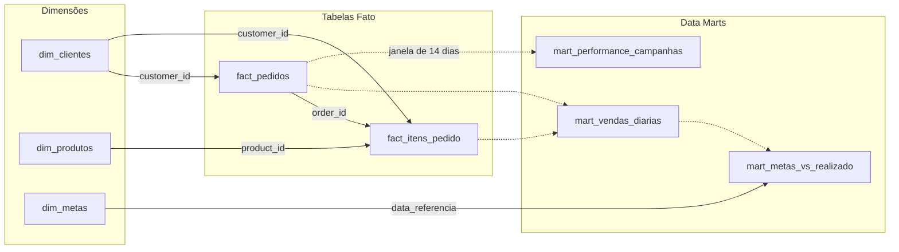

# Veloja Data Pipeline — E-commerce ELT na Google Cloud (Python + GCS + BigQuery + Dataform + Streamlit)


Pipeline corporativo de Engenharia de Dados e Analytics de ponta a ponta para a operação de e-commerce da **Veloja** na Google Cloud Platform. O repositório processa **7 fontes de dados transacionais, de mídia e de planejamento orçamentário** (clientes, produtos, pedidos, itens, pagamentos, eventos de marketing e metas de orçamento, totalizando mais de **322 mil registros** do ano fiscal de 2025) e as estrutura em uma **Arquitetura Medalhão (RAW $\rightarrow$ Trusted $\rightarrow$ Refined)** modelada em **Star Schema e Data Marts** para análise executiva de faturamento, margem de contribuição, atribuição de mídia e **metas vs. realizado**.

O pipeline executa **profiling automatizado e ingestão em Python** para o **Google Cloud Storage** (com geração de manifesto criptográfico SHA-256), mapeia os arquivos no **BigQuery** como *External Tables* na camada **RAW**, higieniza, tipa e deduplica os registros em GoogleSQL na camada **Trusted**, modela a camada **Refined** em **dimensões, fatos e marts**, orquestra a linhagem e dependências via **Google Cloud Dataform (`.sqlx`)**, audita a integridade com uma **suíte de 18 testes automatizados de qualidade de dados** e abastece um **cockpit executivo em Streamlit + Apache ECharts** com rastreamento de metas e semáforo RAG de 4 níveis.

> **Documentação Técnica Oficial:**
>
> * [catalogo_dados.md](catalogo_dados.md) — **Catálogo e Dicionário Oficial de Dados**: glossário executivo de negócio, contratos e esquemas das 3 camadas, regras matemáticas, matriz de linhagem e especificação analítica de BI.
> * [dataform/README.md](dataform/README.md) — **Orquestração e DAG no Dataform**: estrutura `.sqlx`, árvore de dependências `${ref(...)}`, *assertions* embutidas e política de agendamento comercial (`0 6-20 * * *`).
> * [dashboard/README.md](dashboard/README.md) — **Cockpit Executivo Veloja Analytics**: arquitetura da aplicação Streamlit + Apache ECharts, governança de cache e instruções de deploy.

---

## Contexto de Engenharia e Negócio

**Cenário Operacional:** Os arquivos de origem da operação de e-commerce chegam de sistemas transacionais, gateways de pagamento, plataformas de mídia e planilhas de planejamento financeiro (FP&A) com heterogeneidade de formatação:

* **Múltiplos formatos temporais:** na entidade de pedidos, timestamps aparecem em 4 padrões distintos (`2025-05-27 10:32:28`, `27/05/2025 10:32`, `2025/05/27 10:32` e ISO `2025-05-27T10:32:28`).
* **Valores monetários não padronizados:** campos financeiros com símbolos de moeda (`R$`), separadores decimais mistos (vírgula e ponto) e espaços não separáveis (`\u00A0`).
* **Variações de domínio e caixa:** status transacionais (`entregue` vs. `ENTREGUE`, `concluido` vs. `CONCLUIDO`) e métodos de pagamento (`cartao`, `CARTAO`, `cartao_credito`).
* **Duplicidade de eventos na origem:** 1.000 `customer_id` duplicados em clientes e 1.534 `order_id` retransmitidos em pedidos.
* **Ausência de preenchimento:** campos de status, canal, valor pago e dispositivo ausentes em parte dos eventos brutos.
* **Desdobramento de Metas Top-Down:** necessidade de confrontar o orçamento mensal corporativo (FP&A) com a execução diária ponderada pela sazonalidade semanal.

**Solução Arquitetural:**

* Diagnóstico pré-ingestão (*data profiling*) e registro criptográfico de integridade de cada lote enviado ao Data Lake (manifesto JSON com hash SHA-256).
* Preservação imutável do dado bruto no **GCS** e exposição direta no BigQuery via *External Tables* na camada **RAW** (100% `STRING`, zero perda na ingestão).
* Padronização, tipagem forte (`NUMERIC`, `INT64`, `TIMESTAMP`, `BOOL`) e deduplicação determinística via Window Functions na camada **Trusted**.
* Modelagem dimensional **Star Schema** e **Data Marts** na camada **Refined**, materializando regras de **venda válida**, **margem de contribuição**, **atribuição de marketing com janela de 14 dias** e **desdobramento sazonal de metas diárias com semáforo de 4 níveis**.
* Orquestração declarativa no **Google Cloud Dataform** e validação contínua por **18 asserções SQL** de unicidade, reconciliação contábil, integridade referencial e domínio.

---

## Arquitetura Medalhão e Fluxo de Dados

```text
Fontes CSV (data/raw/*_example.csv)
            │
  Python — upload_csv/profiling_data.py  ──▶  output/relatorio_profiling.json
            │
  Python — upload_csv/upload_to_gcs.py   ──▶  output/manifesto.json (tamanho + SHA-256)
            │
  Google Cloud Storage (Data Lake Landing Zone)
  gs://veloja-ecommerce-medalhao-raw/raw/ecommerce/AAAAMMDD/*.csv
            │
  ┌─────────┴────────── BigQuery (southamerica-east1) + Dataform ──────────┐
  │  dataset raw      →  7 External Tables (100% STRING, espelho do CSV)   │
  │        │  SQL / Dataform: limpeza, tipagem forte, deduplicação         │
  │  dataset trusted  →  7 tabelas tipadas e deduplicadas                  │
  │        │  SQL / Dataform: regras de negócio, SKs MD5, agregações       │
  │  dataset refined  →  3 Dimensões + 2 Fatos + 3 Data Marts              │
  │        │                                                               │
  │  sql/04_data_quality/test.sql & dataform/04_assertions/ (Data Quality) │
  └────────────────────────────────────┬───────────────────────────────────┘
                                       │
  Cockpit Executivo — Streamlit + Apache ECharts (cache de 1h, filtros em memória)
```

### 1. Profiling e Ingestão no GCS (`upload_csv/`)

* [`upload_csv/profiling_data.py`](upload_csv/profiling_data.py) inspeciona cada arquivo CSV e exporta [`output/relatorio_profiling.json`](output/relatorio_profiling.json) com volumetria de linhas, colunas, contagem de vazios/nulos por atributo e duplicatas de chave primária.
* [`upload_csv/upload_to_gcs.py`](upload_csv/upload_to_gcs.py) valida variáveis de ambiente, calcula o hash **SHA-256** de cada arquivo, realiza o upload para o prefixo datado (`raw/ecommerce/AAAAMMDD/`) e publica o manifesto de auditoria em `_manifesto/manifesto.json` (espelhado em [`output/manifesto.json`](output/manifesto.json)).
* Autenticação via **ADC** (*Application Default Credentials*): nenhuma chave privada é armazenada no código-fonte.

### 2. Camada RAW (`sql/01_raw/` e `dataform/01_raw/`)

* **External Tables** do BigQuery apontando diretamente para os objetos CSV no bucket do GCS.
* Todos os atributos são declarados como `STRING`, garantindo leitura integral sem falhas de casting na aterrissagem.

### 3. Camada Trusted (`sql/02_trusted/` e `dataform/02_trusted/`)

Cada entidade é processada em 3 etapas estruturadas via CTEs:

* **`limpeza_padronizacao`:** aplicação de `TRIM`, normalização para caixa baixa (`LOWER`), remoção de prefixos monetários (`R$`) e espaços especiais (`\u00A0`), conversão de separador decimal e tratamento padronizado de ausentes (`nao_informado`).
* **`tipificacao`:** `SAFE.PARSE_TIMESTAMP` combinado com `COALESCE` para múltiplos layouts de data, `SAFE_CAST` para `NUMERIC` (valores financeiros e peso), `INT64` (quantidades, parcelas, idade) e `BOOL` (flags de status ativo).
* **`deduplicacao`:** `ROW_NUMBER() OVER (PARTITION BY <pk> ORDER BY ...)` priorizando o registro mais recente e penalizando linhas sinalizadas com observação de duplicidade.

### 4. Camada Refined (`sql/03_refined/` e `dataform/03_refined/`)

* **Dimensões:** `dim_clientes` (com faixas etárias e de renda), `dim_produtos` (com margem unitária de catálogo) e `dim_metas` (calendário 2025 com desdobramento diário ponderado por dia da semana).
* **Fatos:** `fact_pedidos` (valor bruto, desconto, receita líquida, pagamento aprovado e `flag_pedido_valido`) e `fact_itens_pedido` (receita líquida do item, custo total, margem de contribuição e `flag_item_valido`).
* **Data Marts:** `mart_vendas_diarias`, `mart_performance_campanhas` e `mart_metas_vs_realizado`.
* *Surrogate Keys* (`_sk`) determinísticas geradas via `TO_HEX(MD5(id))`.

---

## Regras de Negócio Materializadas

As regras corporativas abaixo são calculadas diretamente no BigQuery e documentadas em detalhes no [Catálogo Oficial de Dados](catalogo_dados.md):

| Regra | Definição Técnica |
| :---- | :---------------- |
| **Pedido válido** (`flag_pedido_valido`) | `status_pedido NOT IN ('cancelado', 'devolvido', 'falha_pagamento')` **e** `valor_pago_aprovado > 0`. |
| **Item válido** (`flag_item_valido`) | `quantidade > 0` **e** `status_item NOT IN ('cancelado', 'devolvido')`. |
| **Receita líquida** | `(quantidade × preco_unitario) − desconto_item` (exclui frete). |
| **Margem de contribuição** | `receita_liquida_item − (quantidade × custo_unitario)`. |
| **Atribuição de marketing (14 dias)** | Um pedido válido é atribuído à campanha quando o cliente converte em até **14 dias** após a interação (`TIMESTAMP_DIFF <= 14 dias`), contabilizando cada pedido uma única vez por par `(campanha, canal)`. |
| **Meta diária sazonal** | O orçamento mensal de receita e pedidos é distribuído pelos dias do mês aplicando pesos de sazonalidade semanal (`1,22` terça-feira a `0,68` domingo), garantindo reconciliação exata com o total mensal. |
| **Semáforo RAG** | Classificação automática de desempenho em `VERDE`, `AMARELO` e `VERMELHO` na camada Refined (e desdobramento visual de 4 níveis com `VERDE ESCURO` $\ge 105\%$ no cockpit executivo). |

---

## Modelagem Dimensional (Star Schema)



| Tabela | Tipo | Grão | Papel Analítico |
| :----- | :--- | :--- | :-------------- |
| `dim_clientes` | Dimensão | 1 linha por cliente | Cadastro higienizado com faixa etária, faixa de renda, localização e canal de aquisição. |
| `dim_produtos` | Dimensão | 1 linha por produto | Catálogo com SKU, categoria, subcategoria, marca, preço de tabela, custo e margem unitária. |
| `dim_metas` | Dimensão | 1 linha por dia de 2025 | Meta diária de receita e pedidos, metas de razão (ticket, margem, ROAS) e limiares de semáforo. |
| `fact_pedidos` | Fato | 1 linha por pedido | Valor bruto dos itens, descontos, frete, receita líquida, pagamento aprovado e flag de venda válida. |
| `fact_itens_pedido` | Fato | 1 linha por item | Quantidade, receita líquida, custo de mercadoria vendida (CMV), margem de contribuição e flag de item válido. |
| `mart_vendas_diarias` | Mart | 1 linha por dia | Pedidos faturados, clientes únicos, receita líquida, ticket médio (AOV), frete e itens expedidos. |
| `mart_performance_campanhas` | Mart | campanha + canal | Investimento em mídia, interações, clientes impactados, pedidos convertidos, receita atribuída e ROAS. |
| `mart_metas_vs_realizado` | Mart | 1 linha por dia | Realizado vs. meta diária, pace acumulado no mês (MTD), banda de tolerância estatística e semáforos. |

---

## Orquestração com Google Cloud Dataform

A pasta [`dataform/`](dataform/) contém a definição declarativa completa do pipeline em **Dataform Core (`.sqlx`)**:

* **`workflow_settings.yaml`:** configuração central apontando para o projeto `veloja-ecommerce-medalhao` na região `southamerica-east1`, com política de execução comercial (`0 6-20 * * *`, fuso `America/Sao_Paulo`).
* **Linhagem Automática (`${ref(...)}`):** as 7 declarações `01_raw`, 7 tabelas `02_trusted` e 8 tabelas `03_refined` declaram suas dependências explicitamente, permitindo execução paralela por camada.
* **Assertions Nativas e Testes Cruzados:** validações `uniqueKey`, `nonNull` e `rowConditions` acopladas a cada tabela, complementadas pelos 4 scripts de reconciliação contábil e integridade referencial em [`dataform/04_assertions/`](dataform/04_assertions/).

Consulte a documentação completa em [`dataform/README.md`](dataform/README.md).

---

## Suíte de Qualidade de Dados (Data Quality)

O script [`sql/04_data_quality/test.sql`](sql/04_data_quality/test.sql) executa **18 testes automatizados** em uma única consulta consolidada no BigQuery (`0` falhas = **PASSOU**):

| Categoria de Teste | Escopo de Validação |
| :----------------- | :------------------ |
| **Unicidade e Chaves** | Chaves naturais e *Surrogate Keys* únicas e não nulas nas 3 dimensões, 2 fatos e 3 data marts. |
| **Consistência Matemática** | `receita_liquida = bruto − desconto`; `margem = receita − custo`; `ticket_medio = receita ÷ pedidos`. |
| **Regras de Domínio** | Nenhum pedido válido com status cancelado/devolvido ou pagamento zerado; faixas etárias e de renda válidas. |
| **Reconciliação Contábil** | A soma da receita líquida em `mart_vendas_diarias` fecha exatamente com a soma dos pedidos válidos em `fact_pedidos`. |
| **Integridade Referencial** | Detecção de pedidos válidos sem cliente em `dim_clientes` e itens válidos sem produto em `dim_produtos` (zero órfãos). |
| **Governança Orçamentária** | 365 dias únicos em `dim_metas`; soma das metas diárias idêntica ao orçamento anual; domínios de semáforo íntegros. |

---

## Cockpit Executivo (Streamlit + Apache ECharts)

A aplicação web em [`dashboard/`](dashboard/) consome diretamente a camada **Refined** no BigQuery com arquitetura voltada a alta performance e eficiência de custos:

* **Cache de 1 hora** (`@st.cache_data(ttl=3600)`): proteção contra leituras repetitivas no BigQuery.
* **Projeção Estrita de Colunas:** consultas SQL otimizadas sem uso de `SELECT *`.
* **Filtros Globais em Memória:** filtragem instantânea por período, mês e canal de origem via Pandas, com **reponderação proporcional da meta pelo *share* de receita do canal selecionado**.
* **Semáforo Executivo de 4 Níveis:** cartões de KPI e gráficos com linhas marcadoras de meta (`markLine`) classificando o atingimento em **Verde Escuro** ($\ge 105\%$), **Verde Claro** ($100\%$ a $104,9\%$), **Amarelo** ($95\%$ a $99,9\%$) e **Vermelho** ($< 95\%$).
* **4 Visões Analíticas Integradas:**
  1. **Visão Executiva de Vendas:** Receita Líquida, Pedidos Faturados, Ticket Médio (AOV), Itens Expedidos, evolução diária vs. meta e participação por canal.
  2. **Produtos & Rentabilidade:** Margem de Contribuição (R$ e %), Desconto Médio vs. Teto, Mix de Categorias, ranking Top 10 produtos e matriz de rentabilidade.
  3. **Campanhas & Retorno de Mídia:** Investimento, Receita Atribuída (14 dias), ROAS Consolidado vs. Meta, volume de interações e tabela de eficiência por campanha.
  4. **Guia de Indicadores & Metas:** Documentação executiva integrada na interface detalhando fórmulas, regras do semáforo e metodologia de metas.

---

## Stack Tecnológica

| Tecnologia | Papel na Arquitetura |
| :--------- | :------------------- |
| **Python 3.12 + Pandas** | Profiling pré-ingestão, geração de manifesto SHA-256 e processamento analítico no dashboard. |
| **uv** | Gerenciamento determinístico de ambiente virtual e dependências Python (`pyproject.toml` / `uv.lock`). |
| **Google Cloud Storage** | Data Lake (*Landing Zone*) para armazenamento versionado por lote dos arquivos CSV brutos e manifestos. |
| **Google BigQuery (GoogleSQL)** | Data Warehouse serverless para as camadas `raw` (External Tables), `trusted` e `refined` (Star Schema + Marts). |
| **Google Cloud Dataform** | Orquestração declarativa da DAG (`.sqlx`), gestão de dependências e asserções automatizadas de qualidade. |
| **gcloud & `bq` CLI** | Provisionamento de infraestrutura, autenticação via ADC e execução automatizada de scripts SQL. |
| **Streamlit + Apache ECharts** | Aplicação web executiva interativa com gráficos customizados e acompanhamento de metas. |

---

## Estrutura do Repositório

```text
ecommerce-elt-gcp-bigquery-dataform-analytics/
├── .env.example                    # Template de variáveis de ambiente do projeto GCP
├── .gitignore                      # Proteção de credenciais, .env, ambientes virtuais e caches locais
├── .python-version                 # Versão do Python gerenciada pelo uv (3.12)
├── pyproject.toml                  # Definição do projeto e dependências do pipeline
├── uv.lock                         # Lockfile determinístico de pacotes
├── README.md                       # Documentação geral da arquitetura e guia de execução
├── catalogo_dados.md               # Catálogo e Dicionário Oficial de Dados (RAW, Trusted, Refined e BI)
│
├── data/
│   └── raw/                        # Lote de arquivos CSV brutos da camada de origem (7 entidades)
│
├── upload_csv/
│   ├── profiling_data.py           # Diagnóstico de volumetria, nulos e duplicatas dos CSVs
│   └── upload_to_gcs.py            # Cálculo de hash SHA-256, geração de manifesto e upload para o GCS
│
├── output/
│   ├── relatorio_profiling.json    # Artefato de diagnóstico pré-ingestão
│   └── manifesto.json              # Manifesto criptográfico SHA-256 do lote ingerido
│
├── sql/
│   ├── 00_setup/
│   │   └── 00_create_datasets.sql  # Criação dos datasets raw, trusted e refined em southamerica-east1
│   ├── 01_raw/
│   │   └── 01_create_raw_table.sql # Mapeamento das 7 External Tables apontando para o GCS
│   ├── 02_trusted/                 # Scripts 01 a 07: higienização, tipagem forte e deduplicação
│   ├── 03_refined/                 # Scripts 01 a 08: dimensões, fatos e data marts (Star Schema)
│   └── 04_data_quality/
│       └── test.sql                # Suíte consolidada com 18 testes automatizados de qualidade
│
├── dataform/
│   ├── workflow_settings.yaml      # Configuração do Dataform Core e política de agendamento comercial
│   ├── README.md                   # Documentação da DAG e comparativo SQL vs. SQLX
│   ├── 01_raw/                     # 7 declarações de fontes brutas (.sqlx)
│   ├── 02_trusted/                 # 7 modelos Trusted com assertions embutidas (.sqlx)
│   ├── 03_refined/                 # 8 modelos Refined (Star Schema + Marts) com assertions (.sqlx)
│   └── 04_assertions/              # 4 testes cruzados de reconciliação contábil e integridade (.sqlx)
│
└── dashboard/
    ├── .gitignore                  # Regras de exclusão de secrets e cache local do Streamlit
    ├── .streamlit/
    │   ├── config.toml             # Configuração visual Dark Mode corporativo
    │   └── secrets.toml.example    # Template de configuração de Service Account para deploy
    ├── src/
    │   ├── __init__.py
    │   ├── data_loader.py          # Camada de conexão BigQuery com cache TTL de 1 hora
    │   └── charts.py               # Especificação dos componentes visuais em Apache ECharts
    ├── app.py                      # Aplicação principal do Cockpit Executivo Veloja Analytics
    ├── requirements.txt            # Dependências para deploy do dashboard
    └── README.md                   # Guia de operação e publicação do dashboard
```

---

## Como Executar o Pipeline

### Pré-requisitos

* Python 3.12 e [uv](https://docs.astral.sh/uv/) instalados.
* Projeto ativo na Google Cloud Platform com as APIs do **Cloud Storage**, **BigQuery** e **Dataform** habilitadas.
* [Google Cloud SDK (`gcloud` e `bq` CLI)](https://cloud.google.com/sdk/docs/install) instalado.

### 1. Instalar Dependências do Projeto

```bash
uv sync
```

### 2. Autenticar na Google Cloud Platform (ADC)

```bash
gcloud auth login
gcloud auth application-default login
gcloud auth application-default set-quota-project <PROJECT_ID>
gcloud config set project <PROJECT_ID>
```

### 3. Configurar Variáveis de Ambiente

Copie o arquivo de referência `.env.example` para `.env` e preencha os identificadores do ambiente:

```bash
cp .env.example .env
```

```env
GCP_PROJECT_ID=veloja-ecommerce-medalhao
GCS_BUCKET_NAME=veloja-ecommerce-medalhao-raw
GCS_RAW_PREFIX=raw/ecommerce
GCP_LOCATION=southamerica-east1
```

### 4. Provisionar Bucket e Datasets no BigQuery

```bash
gcloud storage buckets create gs://veloja-ecommerce-medalhao-raw --location=southamerica-east1

bq query --use_legacy_sql=false < sql/00_setup/00_create_datasets.sql
```

### 5. Executar Profiling e Ingestão para o Data Lake (GCS)

```bash
# Diagnóstico de qualidade dos arquivos CSV brutos
uv run python upload_csv/profiling_data.py

# Geração do manifesto SHA-256 e upload dos 7 arquivos CSV para o GCS
uv run python upload_csv/upload_to_gcs.py
```

### 6. Executar Transformações no BigQuery (via `bq` CLI ou Dataform)

**Opção A — Execução via Scripts SQL (`sql/`):**

```bash
# Camada RAW (External Tables)
bq query --use_legacy_sql=false < sql/01_raw/01_create_raw_table.sql

# Camada Trusted (Higienização, Tipagem e Deduplicação)
for f in sql/02_trusted/*.sql; do bq query --use_legacy_sql=false < "$f"; done

# Camada Refined (Dimensões, Fatos e Data Marts em ordem de dependência)
for f in sql/03_refined/*.sql; do bq query --use_legacy_sql=false < "$f"; done
```

**Opção B — Execução Orquestrada via Google Cloud Dataform (`dataform/`):**

Sincronize o diretório `dataform/` com o seu repositório no Google Cloud Dataform e acione a execução do workflow para compilar a DAG e rodar todas as tabelas e *assertions* automaticamente.

### 7. Executar a Suíte de Qualidade de Dados (18 Assertions)

```bash
bq query --use_legacy_sql=false < sql/04_data_quality/test.sql
```

Todos os 18 testes devem retornar `total_erros = 0` e `status_teste = 'PASSOU'`.

### 8. Iniciar o Cockpit Executivo (Streamlit)

```bash
uv pip install -r dashboard/requirements.txt
uv run streamlit run dashboard/app.py
```

O aplicativo estará disponível em `http://localhost:8501`.
