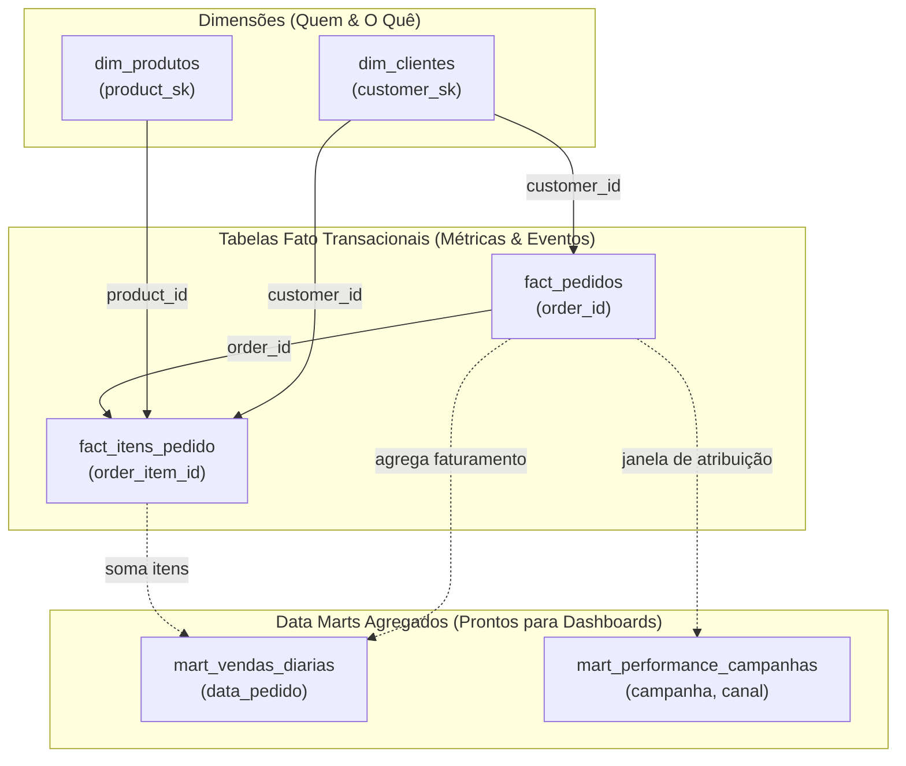

# Catálogo e Dicionário de Dados — E-Commerce Veloja (GCP BigQuery Medalhão)

Este documento é a referência oficial da modelagem e arquitetura de dados do e-commerce **Veloja**, detalhando os esquemas, tipos de dados, regras de negócio, linhagem e a especificação analítica completa abrangendo a arquitetura de ponta a ponta em 3 camadas no Google Cloud Platform (GCS e BigQuery): **Camada RAW (Bronze)**, **Camada Trusted (Silver)**, **Camada Refined (Gold)** e a **Especificação de Métricas / BI**.

---

## Glossário de Siglas e Termos de E-Commerce

* **GMV (*Gross Merchandise Value* / Receita Bruta):** Valor total transacionado na venda de produtos antes de abatimentos de descontos ou devoluções.
* **Receita Líquida (*Net Revenue*):** Faturamento efetivo após dedução de cupons, descontos promocionais por item e frete (conforme regra de negócio da loja).
* **Ticket Médio (*AOV - Average Order Value*):** Valor médio gasto por pedido (`Receita Líquida ÷ Total de Pedidos Válidos`).
* **LTV (*Customer Lifetime Value*):** Valor financeiro total que um cliente gerou para o negócio ao longo de todo o seu histórico de relacionamento.
* **Taxa de Recompra (*Repeat Rate / 60-day Repurchase*):** Percentual de clientes que realizaram um segundo pedido em uma janela de até 60 dias após a primeira compra.
* **Margem Unitária / Margem de Contribuição:** Lucro bruto obtido na venda de uma unidade de produto (`Preço de Tabela - Custo Unitário`).
* **Taxa de Aprovação de Pagamentos (*Approval Rate*):** Proporção de transações financeiras aprovadas com sucesso em relação ao total de tentativas submetidas às adquirentes (`Pagamentos Aprovados ÷ Total de Tentativas`).
* **Chargeback (Contestação):** Cancelamento forçado de uma transação de cartão de crédito solicitado pelo titular do cartão junto ao banco emissor por desacordo comercial ou fraude.
* **Janela de Atribuição de Marketing (*Lookback Window*):** Intervalo de tempo prévio (ex: 7 ou 14 dias antes da data do pedido) no qual um evento de marketing (clique/impressão) é creditado como gerador daquela conversão de venda.
* **SK (*Surrogate Key* / Chave Substituta):** Chave artificial criada na camada analítica (ex: hash SHA256 ou UUID) para identificar unicamente uma entidade dimensional, desacoplando o modelo de BI dos identificadores dos sistemas transacionais de origem.

---

# PARTE 1: CAMADA RAW (Bronze / Landing Zone)

## Informações Gerais da Camada RAW

* **Ambiente de Armazenamento:** Google Cloud Storage (Data Lake) e Google Cloud BigQuery (Tabelas Externas / *External Tables*).
* **Localização dos Arquivos no GCS:** `gs://veloja-ecommerce-medalhao-raw/raw/ecommerce/20261107/*.csv`
* **Dataset no BigQuery:** `veloja-ecommerce-medalhao.raw`
* **Região:** `southamerica-east1` (São Paulo).
* **Regra de Ouro da Camada RAW:** Todos os campos são declarados como **`STRING`**. Nenhuma transformação, correção ortográfica, cast numérico ou filtro de duplicatas é permitido aqui. A camada RAW é o espelho exato e imutável dos arquivos CSV que aterrissaram no bucket.
* **Metadado de Integridade (Manifesto):** Cada lote ingerido no bucket possui um arquivo de manifesto (`_manifesto/manifesto.json`) contendo o nome do arquivo, tamanho em bytes, hash criptográfico SHA-256 para auditoria de integridade e timestamp do upload.

---

### 1.1 Tabela RAW: `clientes`

* **Origem GCS:** `gs://veloja-ecommerce-medalhao-raw/raw/ecommerce/20261107/clientes.csv`
* **Tabela BigQuery:** `veloja-ecommerce-medalhao.raw.clientes` (External Table)
* **Descrição:** Dados cadastrais brutos dos clientes exportados do banco transacional da loja.
* **Volumetria Bruta:** 125 linhas (contém 5 duplicatas de `customer_id` decorrentes de atualizações cadastrais históricas).

| Coluna               | Tipo BigQuery | Nulo? | Descrição da Origem     | Problemas e Inconsistências Reais no CSV Bruto                                                             |
| :--------------------- | :-------------- | :-----: | :-------------------------- | :------------------------------------------------------------------------------------------------------------ |
| `customer_id`        | `STRING`      | Não | Identificador do cliente  | Chaves repetidas devido a múltiplas versões do mesmo cliente.                                             |
| `nome`               | `STRING`      |  Sim  | Nome completo             | Variações de caixa alta/baixa e espaços extras antes/depois do nome.                                     |
| `email`              | `STRING`      |  Sim  | E-mail de cadastro        | Variações de caixa alta/baixa.                                                                            |
| `cpf_hash`           | `STRING`      |  Sim  | Hash do CPF anonimizado   | String criptográfica gerada na extração da origem.                                                       |
| `data_cadastro`      | `STRING`      |  Sim  | Data do registro da conta | Múltiplos formatos na mesma coluna (`17/07/2024`, `2024-08-23`, `2025/05/25`) e vazios.                    |
| `cidade`             | `STRING`      |  Sim  | Município residencial    | Espaços excedentes e variações de acentuação.                                                          |
| `estado`             | `STRING`      |  Sim  | Unidade Federativa        | Variações de espaçamento e letras minúsculas.                                                           |
| `pais`               | `STRING`      |  Sim  | País de residência      | Presença de `"Brasil"`, `"BRASIL"` e `"BR"`.                                                               |
| `canal_aquisicao`    | `STRING`      |  Sim  | Primeiro ponto de contato | Textos com espaços (`"Paid Search"`, `"paid search"`), nulos e vazios.                                     |
| `ativo`              | `STRING`      |  Sim  | Status da conta           | Valores booleanos expressos como texto heterogêneo (`"true"`, `"false"`, `"1"`, `"0"`, `"sim"`, `"s"`).    |
| `idade`              | `STRING`      |  Sim  | Idade declarada           | Representada como texto, com possíveis valores nulos.                                                      |
| `renda_estimada`     | `STRING`      |  Sim  | Renda mensal estimada     | Mistura de ponto decimal (`5946.59`), vírgula decimal (`"10032,00"`), símbolo `"R$"` e espaços.          |
| `ultima_atualizacao` | `STRING`      |  Sim  | Carimbo de atualização  | Datas em formatos mistos com e sem hora (`2024-09-17 01:46:00`, `2025/03/23 21:20`, `2023-09-29T12:38:00`). |

---

### 1.2 Tabela RAW: `produtos`

* **Origem GCS:** `gs://veloja-ecommerce-medalhao-raw/raw/ecommerce/20261107/produtos.csv`
* **Tabela BigQuery:** `veloja-ecommerce-medalhao.raw.produtos` (External Table)
* **Descrição:** Catálogo de produtos bruto exportado do ERP comercial.
* **Volumetria Bruta:** 53 linhas (contém 3 duplicatas de `product_id`: `P0003`, `P0011` e `P0029`).

| Coluna              | Tipo BigQuery | Nulo? | Descrição da Origem      | Problemas e Inconsistências Reais no CSV Bruto                                        |
| :-------------------- | :-------------- | :-----: | :--------------------------- | :--------------------------------------------------------------------------------------- |
| `product_id`        | `STRING`      | Não | Código do produto         | Duplicatas de chave primária com divergência no status de ativação.                |
| `sku`               | `STRING`      | Não | Código de estoque         | Códigos alfanuméricos (`SKU-MOD-0001`).                                              |
| `nome_produto`      | `STRING`      | Não | Descrição comercial      | Variações de capitalização.                                                        |
| `categoria`         | `STRING`      | Não | Categoria macro            | Mistura de caixa (`"Moda"`, `"CASA"`, `"casa"`).                                       |
| `subcategoria`      | `STRING`      | Não | Subdivisão do produto     | Variações de caixa e espaçamentos.                                                  |
| `marca`             | `STRING`      | Não | Nome do fabricante         | Variações textuais (`"Aurora"`, `"Zenit"`, `"Koru"`).                                |
| `preco_tabela`      | `STRING`      | Não | Preço de lista            | Formatação brasileira com vírgula (`"268,27"`), ponto (`897.21`) e símbolo `"R$"`. |
| `custo_unitario`    | `STRING`      | Não | Custo de compra unitário  | Formatação monetária mista com vírgulas e pontos decimais.                         |
| `ativo`             | `STRING`      |  Sim  | Disponibilidade em estoque | Variações textuais (`"0"`, `"false"`, `"S"`, `"true"`).                              |
| `data_inicio_venda` | `STRING`      |  Sim  | Data de lançamento        | Formatos mistos de data sem horário (`2024-11-30`, `20/07/2023`, `2025/01/06`).       |
| `peso_kg`           | `STRING`      |  Sim  | Peso em quilogramas        | Números com vírgula (`"5,959"`) e números com ponto (`5.581`).                      |

---

### 1.3 Tabela RAW: `pedidos`

* **Origem GCS:** `gs://veloja-ecommerce-medalhao-raw/raw/ecommerce/20261107/pedidos.csv`
* **Tabela BigQuery:** `veloja-ecommerce-medalhao.raw.pedidos` (External Table)
* **Descrição:** Cabeçalho das vendas efetuadas na plataforma de e-commerce.
* **Volumetria Bruta:** 324 linhas (contém 4 pedidos duplicados propositais para teste de tratamento).

| Coluna           | Tipo BigQuery | Nulo? | Descrição da Origem    | Problemas e Inconsistências Reais no CSV Bruto                                                            |
| :----------------- | :-------------- | :-----: | :------------------------- | :----------------------------------------------------------------------------------------------------------- |
| `order_id`       | `STRING`      | Não | Identificador do pedido  | Duplicatas intencionais identificadas com a observação `"duplicidade proposital para tratamento"`.       |
| `customer_id`    | `STRING`      | Não | Cliente associado        | Contém chaves órfãs (clientes que não existem na tabela `clientes`).                                   |
| `data_pedido`    | `STRING`      | Não | Data/hora da compra      | Mistura de 5 formatos: com segundos, com minutos, ISO com `'T'` e padrão brasileiro (`11/09/2025 04:13`). |
| `status_pedido`  | `STRING`      |  Sim  | Estado do pedido         | Variações de grafia (`"em separacao"`, `"Aprovado"`, `"CONCLUIDO"`, `"pago"`), nulos e vazios.           |
| `origem_pedido`  | `STRING`      |  Sim  | Canal de venda           | Mistura de maiúsculas/minúsculas (`"SITE"`, `"site"`, `"app"`, `"App"`, `"loja_fisica"`) e nulos.        |
| `cupom`          | `STRING`      |  Sim  | Cupom promocional        | Valores válidos misturados com texto `"NULL"`, `"CUPOM_INVALIDO"` e strings vazias.                       |
| `frete`          | `STRING`      |  Sim  | Valor cobrado pelo frete | Textos como `"R$ 0,00"`, `"0,00"`, `" 0.00 "`, decimais com vírgula (`"43,23"`) e vazios.                 |
| `cidade_entrega` | `STRING`      |  Sim  | Cidade de entrega        | Espaçamentos extras e divergências de grafia sem acento.                                                 |
| `estado_entrega` | `STRING`      |  Sim  | Estado de entrega        | Siglas com letras minúsculas ou espaçadas.                                                               |
| `observacao`     | `STRING`      |  Sim  | Anotações do checkout  | Textos livres, anotações de auditoria (`"duplicidade proposital..."`) e quebras de linha em aspas.       |

---

### 1.4 Tabela RAW: `itens_pedido`

* **Origem GCS:** `gs://veloja-ecommerce-medalhao-raw/raw/ecommerce/20261107/itens_pedido.csv`
* **Tabela BigQuery:** `veloja-ecommerce-medalhao.raw.itens_pedido` (External Table)
* **Descrição:** Linhas de itens de produtos vinculados a cada pedido.
* **Volumetria Bruta:** 812 linhas (contém 3 duplicatas idênticas de `order_item_id`).

| Coluna           | Tipo BigQuery | Nulo? | Descrição da Origem   | Problemas e Inconsistências Reais no CSV Bruto                                                 |
| :----------------- | :-------------- | :-----: | :------------------------ | :------------------------------------------------------------------------------------------------ |
| `order_item_id`  | `STRING`      | Não | Identificador do item   | Duplicatas exatas de linhas completas (`I0000011`, `I0000100`, `I0000251`).                     |
| `order_id`       | `STRING`      | Não | Pedido pai              | Presença de chaves órfãs.                                                                    |
| `product_id`     | `STRING`      | Não | Produto vendido         | Presença de códigos que não constam no cadastro de produtos.                                 |
| `quantidade`     | `STRING`      |  Sim  | Unidades compradas      | Presença de valores negativos intencionais (`-2`) que representam anomalias para auditoria.    |
| `preco_unitario` | `STRING`      | Não | Valor unitário cobrado | Presença de `"R$"`, espaços extras (`" 748.53 "`) e vírgulas decimais (`"271,38"`).          |
| `desconto_item`  | `STRING`      |  Sim  | Desconto do item        | Formatações com `"R$"`, valores com vírgula, nulos e descontos que superam o preço do item. |
| `status_item`    | `STRING`      |  Sim  | Status da linha do item | Valores em caixa mista (`"OK"`, `"ok"`, `"cancelado"`, `"devolvido"`) e campos nulos.           |

---

### 1.5 Tabela RAW: `pagamentos`

* **Origem GCS:** `gs://veloja-ecommerce-medalhao-raw/raw/ecommerce/20261107/pagamentos.csv`
* **Tabela BigQuery:** `veloja-ecommerce-medalhao.raw.pagamentos` (External Table)
* **Descrição:** Registros de liquidação financeira e transações com adquirentes.
* **Volumetria Bruta:** 323 linhas.

| Coluna               | Tipo BigQuery | Nulo? | Descrição da Origem      | Problemas e Inconsistências Reais no CSV Bruto                                                              |
| :--------------------- | :-------------- | :-----: | :--------------------------- | :------------------------------------------------------------------------------------------------------------- |
| `payment_id`         | `STRING`      | Não | Identificador do pagamento | Identificadores únicos (`PAY0000001`).                                                                      |
| `order_id`           | `STRING`      | Não | Pedido relacionado         | Pedidos com pagamentos divididos em múltiplos registros (1:N).                                              |
| `data_pagamento`     | `STRING`      |  Sim  | Data/hora da transação   | Formatos variados com barras, traços e ISO (`25/01/2024 11:00`, `2024-04-22T00:00:00`).                     |
| `metodo_pagamento`   | `STRING`      |  Sim  | Meio de pagamento          | Inconsistência de taxonomia (`"CARTAO"` vs `"cartao_credito"`, `"Pix"` vs `"pix"`, `"boleto"`, `"wallet"`). |
| `status_pagamento`   | `STRING`      |  Sim  | Status do gateway          | Variações de caixa (`"aprovado"`, `"APROVADO"`), vazios e transações recusadas/estornadas.               |
| `valor_pago`         | `STRING`      |  Sim  | Montante cobrado           | Mistura de `"R$"`, espaços não separáveis (`\u00A0`), vírgulas (`"642,94"`) e pontos.                    |
| `parcelas`           | `STRING`      |  Sim  | Número de parcelas        | Números como texto (`"1"`, `"6"`, `"12"`) e campos em branco.                                               |
| `adquirente`         | `STRING`      |  Sim  | Processadora de cartão    | Nomes de adquirentes com campos nulos (`"Cielo"`, `"Stone"`, `"Rede"`, `"Pagar.me"`).                        |
| `codigo_autorizacao` | `STRING`      |  Sim  | Código do gateway         | Strings alfanuméricas com valores vazios e nulos.                                                           |

---

### 1.6 Tabela RAW: `eventos_marketing`

* **Origem GCS:** `gs://veloja-ecommerce-medalhao-raw/raw/ecommerce/20261107/eventos_marketing.csv`
* **Tabela BigQuery:** `veloja-ecommerce-medalhao.raw.eventos_marketing` (External Table)
* **Descrição:** Logs de impressões, cliques e conversões de marketing digital.
* **Volumetria Bruta:** 500 linhas.

| Coluna (Cabeçalho RAW) | Tipo BigQuery | Nulo? | Significado Real no CSV Bruto | Deslocamento Crítico Identificado na Origem                                             |
| :------------------------ | :-------------- | :-----: | :------------------------------ | :----------------------------------------------------------------------------------------- |
| `event_id`              | `STRING`      | Não | ID do evento                  | Identificador único (`E0000001`).                                                       |
| `customer_id`           | `STRING`      |  Sim  | ID do cliente                 | Contém 29 eventos com cliente nulo (navegação e impressões anônimas).               |
| `data_evento`           | `STRING`      | Não | Data da interação           | Formatos mistos com e sem segundos (`29/10/2025 22:06`, `2026-02-07T12:52:00`).          |
| `tipo_evento`           | `STRING`      | Não | **CAMPANHA**                  | **Deslocado:** Traz o nome da campanha (`volta_as_aulas`, `black_friday_2025`).          |
| `origem_campanha`       | `STRING`      |  Sim  | **CANAL**                     | **Deslocado:** Traz o canal de aquisição (`push`, `afiliados`, `paid_search`).         |
| `meio_campanha`         | `STRING`      |  Sim  | **TIPO DO EVENTO**            | **Deslocado:** Traz a ação do usuário (`impressao`, `compra_assistida`, `clique`).    |
| `nome_campanha`         | `STRING`      | Não | **CUSTO DA MÍDIA**           | **Deslocado:** Traz o valor financeiro do clique/evento (`0.60`, `"R$ 7,00"`, `"4,29"`). |
| `dispositivo`           | `STRING`      |  Sim  | **DEVICE**                    | Variações de caixa (`"MOBILE"`, `"mobile"`, `"tablet"`, `"desktop"`) e nulos.          |

---

# PARTE 2: CAMADA TRUSTED (Silver Tratada)

## Informações Gerais da Camada Trusted

* **Ambiente de Armazenamento:** Google Cloud BigQuery (Tabelas Nativas com Storage Colunar Capacitor).
* **Dataset:** `veloja-ecommerce-medalhao.trusted`
* **Região:** `southamerica-east1` (São Paulo).
* **Propósito:** Armazenar dados limpos, deduplicados e tipados (sem mais campos `STRING` genéricos). Os dados da Trusted preservam a fidelidade do que ocorreu no negócio, tratando formatos corrompidos de data, moeda e categorias, mas preservando anomalias reais para fins de auditoria.
* **Metadado Padrão de Auditoria:**
  * `data_processamento` (`TIMESTAMP`): Carimbo UTC de data e hora exata em que o pipeline executou a transformação e carregou a linha na camada Trusted.

---

### 2.1 Tabela Trusted: `clientes`

* **Dataset / Tabela:** `veloja-ecommerce-medalhao.trusted.clientes`
* **Descrição:** Cadastro mestre dos clientes da loja virtual com atributos demográficos, canais de atração e estado cadastral.
* **Granularidade:** Uma linha por cliente único (`customer_id`).
* **Regras de Tratamento:** Deduplicado pelo `customer_id` mantendo o registro com `ultima_atualizacao` mais recente (`ROW_NUMBER() OVER (PARTITION BY customer_id ORDER BY ultima_atualizacao DESC NULLS LAST) = 1`). Normalização de texto, canais de aquisição e conversão de idade e renda estimada.

| Coluna               | Tipo BigQuery | Nulo? | Chave | Descrição e Regras de Limpeza                                                                              | Exemplo de Saída             |
| :--------------------- | :-------------- | :-----: | :------: | :------------------------------------------------------------------------------------------------------------- | :------------------------------ |
| `customer_id`        | `STRING`      | Não | **PK** | Identificador único do cliente (alfanumérico). Limpeza com `TRIM`.                                         | `"C0001"`                     |
| `nome`               | `STRING`      |  Sim  |   —   | Nome completo do cliente padronizado em minúsculo e sem espaços extras.                                    | `"ana beatriz silva"`         |
| `email`              | `STRING`      |  Sim  |   —   | E-mail de contato padronizado em minúsculo (`LOWER(TRIM(email))`).                                          | `"ana.silva@email.com"`       |
| `cpf_hash`           | `STRING`      |  Sim  |   —   | Hash criptográfico do documento para proteção de dados pessoais (LGPD).                                   | `"a9f4c3d8..."`               |
| `data_cadastro`      | `DATE`        |  Sim  |   —   | Data original de criação da conta. Tratada com `COALESCE` para `%d/%m/%Y`, `%Y-%m-%d` e `%Y/%m/%d`.        | `2024-07-17`                  |
| `cidade`             | `STRING`      |  Sim  |   —   | Cidade do cliente com espaços extras removidos via `TRIM`.                                                  | `"Campinas"`                  |
| `estado`             | `STRING`      |  Sim  |   —   | Sigla da Unidade Federativa em duas letras maiúsculas (`UPPER(TRIM(estado))`).                              | `"SP"`                        |
| `pais`               | `STRING`      |  Sim  |   —   | Código do país normalizado (substituindo `"BRASIL"` por `"BR"`).                                           | `"BR"`                        |
| `canal_aquisicao`    | `STRING`      | Não |   —   | Canal de origem do cadastro normalizado (`'paid search'` -> `'paid_search'`; nulos viram `'nao_informado'`). | `"organico"`, `"paid_search"` |
| `ativo`              | `BOOL`        | Não |   —   | Flag booleana do status da conta (`'true'`, `'1'`, `'sim'`, `'s'` -> `TRUE`; demais -> `FALSE`).             | `TRUE`, `FALSE`               |
| `idade`              | `INT64`       |  Sim  |   —   | Idade em anos inteiros com validação de consistência biológica (`BETWEEN 0 AND 120`).                    | `24`, `35`                    |
| `renda_estimada`     | `NUMERIC`     |  Sim  |   —   | Renda mensal estimada em reais. Remove caracteres não numéricos e converte vírgula decimal para ponto.    | `5946.59`, `10032.00`         |
| `ultima_atualizacao` | `TIMESTAMP`   |  Sim  |   —   | Timestamp da última modificação cadastral (usado na deduplicação temporal).                             | `2024-09-17 01:46:00 UTC`     |
| `data_processamento` | `TIMESTAMP`   | Não |   —   | Data e hora em que o registro foi gravado na camada Trusted.                                                 | `CURRENT_TIMESTAMP()`         |

---

### 2.2 Tabela Trusted: `produtos`

* **Dataset / Tabela:** `veloja-ecommerce-medalhao.trusted.produtos`
* **Descrição:** Catálogo de produtos comercializados pela Veloja com hierarquia de categorias, preços vigentes de tabela e custos unitários.
* **Granularidade:** Uma linha por produto único (`product_id`).
* **Regras de Tratamento:** Deduplicação por `product_id` priorizando o registro com `ativo = TRUE` e data de início de venda mais recente. Valores monetários e peso convertidos com segurança para `NUMERIC`.

| Coluna               | Tipo BigQuery | Nulo? | Chave | Descrição e Regras de Limpeza                                                                    | Exemplo de Saída     |
| :--------------------- | :-------------- | :-----: | :------: | :--------------------------------------------------------------------------------------------------- | :---------------------- |
| `product_id`         | `STRING`      | Não | **PK** | Código identificador do produto no catálogo.                                                     | `"P0001"`             |
| `sku`                | `STRING`      | Não |   —   | *Stock Keeping Unit* (código de estoque de barras/logística).                                    | `"SKU-MOD-0001"`      |
| `nome_produto`       | `STRING`      | Não |   —   | Nome comercial do produto em minúsculo e sem espaços excedentes.                                 | `"zenit camisetas 1"` |
| `categoria`          | `STRING`      | Não |   —   | Macro-categoria mercadológica em minúsculo (`"moda"`, `"casa"`).                                 | `"moda"`              |
| `subcategoria`       | `STRING`      | Não |   —   | Subdivisão da categoria em minúsculo (`"camisetas"`, `"decoracao"`).                             | `"camisetas"`         |
| `marca`              | `STRING`      | Não |   —   | Marca fabricante padronizada em minúsculo.                                                        | `"aurora"`, `"zenit"` |
| `preco_tabela`       | `NUMERIC`     | Não |   —   | Preço unitário de lista em Reais. Tratado com `REGEXP_REPLACE` e vírgula convertida para ponto. | `268.27`              |
| `custo_unitario`     | `NUMERIC`     | Não |   —   | Custo de aquisição/fabricação unitário em Reais (base para cálculo de margem).               | `187.98`              |
| `ativo`              | `BOOL`        | Não |   —   | Disponibilidade para venda ativa (`'true'`, `'1'`, `'sim'`, `'s'` -> `TRUE`; demais -> `FALSE`).   | `TRUE`                |
| `data_inicio_venda`  | `DATE`        |  Sim  |   —   | Data em que o produto foi lançado para venda (`%Y-%m-%d`, `%d/%m/%Y`, `%Y/%m/%d`).                | `2024-11-30`          |
| `peso_kg`            | `NUMERIC`     |  Sim  |   —   | Peso unitário do item em quilogramas (usado para cálculo de frete).                              | `5.581`               |
| `data_processamento` | `TIMESTAMP`   | Não |   —   | Data e hora em que o registro foi gravado na camada Trusted.                                       | `CURRENT_TIMESTAMP()` |

---

### 2.3 Tabela Trusted: `pedidos`

* **Dataset / Tabela:** `veloja-ecommerce-medalhao.trusted.pedidos`
* **Descrição:** Cabeçalho de todos os pedidos de compra realizados no e-commerce, registrando o canal de venda, frete, localização de entrega e status operacional.
* **Granularidade:** Uma linha por pedido único (`order_id`).
* **Regras de Tratamento:** Deduplicado por `order_id` eliminando linhas propositais de duplicidade (`observacao LIKE '%duplicidade%'`). Conversão de `data_pedido` para `TIMESTAMP` e padronização dos canais de origem e status de entrega.

| Coluna               | Tipo BigQuery | Nulo? | Chave | Descrição e Regras de Limpeza                                                                             | Exemplo de Saída           |
| :--------------------- | :-------------- | :-----: | :------: | :------------------------------------------------------------------------------------------------------------ | :---------------------------- |
| `order_id`           | `STRING`      | Não | **PK** | Código único do pedido transacionado.                                                                     | `"O000001"`                 |
| `customer_id`        | `STRING`      | Não | **FK** | Código do cliente comprador (pode conter órfãos a serem tratados na Refined).                            | `"C0084"`                   |
| `data_pedido`        | `TIMESTAMP`   | Não |   —   | Timestamp exato da realização do pedido (abrange 5 máscaras de formato de data/hora).                    | `2024-01-24 17:13:00 UTC`   |
| `status_pedido`      | `STRING`      | Não |   —   | Situação operacional normalizada (`'aguardando_pagamento'`, `'pago'`, `'entregue'`, `'cancelado'`, etc.). | `"pago"`, `"entregue"`      |
| `origem_pedido`      | `STRING`      | Não |   —   | Canal de fechamento da venda (`'site'`, `'app'`, `'loja_fisica'`, `'marketplace'`).                         | `"site"`, `"app"`           |
| `cupom`              | `STRING`      |  Sim  |   —   | Código promocional aplicado no checkout. Textos vazios e `'NULL'` viram `NULL` real.                       | `"BEMVINDO10"`, `NULL`      |
| `frete`              | `NUMERIC`     | Não |   —   | Valor cobrado pelo frete em Reais. Tratamento de `'R$'` e vazios com fallback para `0.00`.                  | `0.00`, `43.23`             |
| `cidade_entrega`     | `STRING`      |  Sim  |   —   | Município de destino da entrega do pedido.                                                                 | `"Sao Paulo"`, `"Salvador"` |
| `estado_entrega`     | `STRING`      |  Sim  |   —   | Sigla do Estado da entrega em maiúsculo (`UPPER(TRIM(estado_entrega))`).                                   | `"SP"`, `"BA"`              |
| `observacao`         | `STRING`      |  Sim  |   —   | Observações livres do cliente ou do sistema operacional de despacho.                                      | `"entregar apos as 18h"`    |
| `data_processamento` | `TIMESTAMP`   | Não |   —   | Data e hora em que o registro foi gravado na camada Trusted.                                                | `CURRENT_TIMESTAMP()`       |

---

### 2.4 Tabela Trusted: `itens_pedido`

* **Dataset / Tabela:** `veloja-ecommerce-medalhao.trusted.itens_pedido`
* **Descrição:** Registra a composição de produtos de cada pedido vendido (tabela fato transacional de maior granularidade).
* **Granularidade:** Uma linha por item de pedido (`order_item_id`).
* **Regras de Tratamento:** Deduplicado por `order_item_id`. Tratamento de preços e descontos para `NUMERIC`. Preservação explícita de quantidades `<= 0` para permitir a execução de consultas de auditoria e controle de qualidade de dados.

| Coluna               | Tipo BigQuery | Nulo? | Chave | Descrição e Regras de Limpeza                                                            | Exemplo de Saída     |
| :--------------------- | :-------------- | :-----: | :------: | :------------------------------------------------------------------------------------------- | :---------------------- |
| `order_item_id`      | `STRING`      | Não | **PK** | Identificador exclusivo do item do pedido.                                                 | `"I0000001"`          |
| `order_id`           | `STRING`      | Não | **FK** | Pedido ao qual o item pertence (relaciona com `trusted.pedidos.order_id`).                 | `"O000001"`           |
| `product_id`         | `STRING`      | Não | **FK** | Código do produto adquirido (relaciona com `trusted.produtos.product_id`).                | `"P0011"`             |
| `quantidade`         | `INT64`       |  Sim  |   —   | Quantidade de unidades vendidas. Valores negativos preservados para auditoria.             | `2`, `-2`             |
| `preco_unitario`     | `NUMERIC`     | Não |   —   | Preço real cobrado pelo item no instante da venda (em Reais).                             | `321.47`              |
| `desconto_item`      | `NUMERIC`     | Não |   —   | Valor monetário de desconto rateado/aplicado ao item (fallback para `0.00` quando vazio). | `14.76`, `0.00`       |
| `status_item`        | `STRING`      | Não |   —   | Status específico do item (`'ok'`, `'cancelado'`, `'devolvido'`, `'nao_informado'`).      | `"ok"`, `"cancelado"` |
| `data_processamento` | `TIMESTAMP`   | Não |   —   | Data e hora em que o registro foi gravado na camada Trusted.                               | `CURRENT_TIMESTAMP()` |

---

### 2.5 Tabela Trusted: `pagamentos`

* **Dataset / Tabela:** `veloja-ecommerce-medalhao.trusted.pagamentos`
* **Descrição:** Registra todas as tentativas e transações financeiras submetidas às operadoras para quitação dos pedidos.
* **Granularidade:** Uma linha por transação de pagamento (`payment_id`). Um pedido pode conter múltiplos pagamentos (1:N).
* **Regras de Tratamento:** Deduplicado por `payment_id`. Padronização de métodos de pagamento (`'CARTAO'` e `'cartao_credito'` unificados em `'cartao_credito'`), status padronizados e valores convertidos para `NUMERIC`.

| Coluna               | Tipo BigQuery | Nulo? | Chave | Descrição e Regras de Limpeza                                                                      | Exemplo de Saída           |
| :--------------------- | :-------------- | :-----: | :------: | :----------------------------------------------------------------------------------------------------- | :---------------------------- |
| `payment_id`         | `STRING`      | Não | **PK** | Identificador exclusivo da transação de pagamento.                                                 | `"PAY0000001"`              |
| `order_id`           | `STRING`      | Não | **FK** | Pedido associado ao pagamento (relaciona com `trusted.pedidos.order_id`).                            | `"O000001"`                 |
| `data_pagamento`     | `TIMESTAMP`   |  Sim  |   —   | Timestamp em que a adquirente processou a transação.                                               | `2024-01-25 11:00:00 UTC`   |
| `metodo_pagamento`   | `STRING`      | Não |   —   | Método normalizado (`'cartao_credito'`, `'pix'`, `'boleto'`, `'wallet'`, `'nao_informado'`).        | `"cartao_credito"`, `"pix"` |
| `status_pagamento`   | `STRING`      | Não |   —   | Situação da transação (`'aprovado'`, `'pendente'`, `'estornado'`, `'recusado'`, `'chargeback'`). | `"aprovado"`, `"recusado"`  |
| `valor_pago`         | `NUMERIC`     |  Sim  |   —   | Montante em Reais transacionado no pagamento.                                                        | `642.94`, `2550.26`         |
| `parcelas`           | `INT64`       |  Sim  |   —   | Número de parcelas escolhidas no checkout (número inteiro de 1 a 12).                              | `1`, `6`, `12`              |
| `adquirente`         | `STRING`      | Não |   —   | Processadora do pagamento (`"Cielo"`, `"Stone"`, `"Pagar.me"`, `"Mercado Pago"`, `"Rede"`).          | `"Stone"`, `"Cielo"`        |
| `codigo_autorizacao` | `STRING`      |  Sim  |   —   | Código alfanumérico retornado pelo gateway de pagamento.                                           | `"J2O4Q067"`                |
| `data_processamento` | `TIMESTAMP`   | Não |   —   | Data e hora em que o registro foi gravado na camada Trusted.                                         | `CURRENT_TIMESTAMP()`       |

---

### 2.6 Tabela Trusted: `eventos_marketing`

* **Dataset / Tabela:** `veloja-ecommerce-medalhao.trusted.eventos_marketing`
* **Descrição:** Registro de interações de mídia e marketing digital dos usuários com as campanhas de marketing da Veloja.
* **Granularidade:** Uma linha por evento de marketing (`event_id`).
* **Regras de Tratamento:** Correção do mapeamento de colunas invertidas da origem RAW. Preservação de `customer_id` nulo para eventos anônimos (navegação pré-cadastro). Custo convertido para `NUMERIC`.

| Coluna               | Tipo BigQuery | Nulo? | Chave | Descrição e Regras de Limpeza                                                                   | Exemplo de Saída                    |
| :--------------------- | :-------------- | :-----: | :------: | :-------------------------------------------------------------------------------------------------- | :------------------------------------- |
| `event_id`           | `STRING`      | Não | **PK** | Código identificador exclusivo do evento de campanha.                                            | `"E0000001"`                         |
| `customer_id`        | `STRING`      |  Sim  | **FK** | Cliente impactado pelo anúncio (nulo quando usuário navega sem login).                          | `"C0007"`, `NULL`                    |
| `data_evento`        | `TIMESTAMP`   | Não |   —   | Data e hora em que a interação ocorreu (conversão de 5 formatos).                              | `2025-10-29 22:06:00 UTC`            |
| `campanha`           | `STRING`      | Não |   —   | Nome da ação promocional normalizada em minúsculo (deslocada da coluna `tipo_evento` do RAW).  | `"volta_as_aulas"`, `"black_friday"` |
| `canal`              | `STRING`      | Não |   —   | Canal de tráfego (`"push"`, `"afiliados"`, `"email"`, `"paid_search"`, `"social"`, `"display"`). | `"push"`, `"paid_search"`            |
| `tipo_evento`        | `STRING`      | Não |   —   | Tipo de interação (`"impressao"`, `"clique"`, `"add_to_cart"`, `"email_aberto"`, `"lead"`).     | `"impressao"`, `"clique"`            |
| `custo_campanha`     | `NUMERIC`     | Não |   —   | Custo em Reais daquele evento unitário (deslocado da coluna `nome_campanha` do RAW).             | `0.60`, `7.00`                       |
| `device`             | `STRING`      | Não |   —   | Dispositivo utilizado pelo usuário (`"mobile"`, `"desktop"`, `"tablet"`).                        | `"mobile"`, `"desktop"`              |
| `data_processamento` | `TIMESTAMP`   | Não |   —   | Data e hora em que o registro foi gravado na camada Trusted.                                      | `CURRENT_TIMESTAMP()`                |

---

# PARTE 3: CAMADA REFINED (Gold - Modelagem Dimensional & Star Schema)

## Informações Gerais da Camada Refined

* **Dataset:** `veloja-ecommerce-medalhao.refined`
* **Modelo Analítico:** Star Schema (Esquema Estrela) e Data Marts Agregados, otimizado para ferramentas de BI (Looker Studio, Power BI, Qlik, Tableau).
* **Propósito:** Materializar regras de negócio consolidadas, chaves substitutas (`_sk`), cálculo prévio de margens e métricas financeiras, e isolamento de flags de auditoria (`flag_pedido_valido`, `flag_item_valido`). Permite que analistas de BI façam consultas analíticas de alta performance sem precisar de queries complexas com dezenas de `JOINs`.

---

### 3.1 Tabela Dimensão: `dim_clientes`

* **Dataset / Tabela:** `veloja-ecommerce-medalhao.refined.dim_clientes`
* **Descrição:** Dimensão de clientes enriquecida com segmentação analítica por faixas etárias e faixas de renda familiar (*buckets*).
* **Granularidade:** Uma linha por cliente único (`customer_sk`).
* **Regra de Construção:**
  * Chave Substituta (`customer_sk`): Gerada via hash seguro `TO_HEX(MD5(customer_id))`.
  * `faixa_idade`: Mapeia a idade numérica em grupos demográficos (`'18-24'`, `'25-34'`, `'35-49'`, `'50-64'`, `'65+'`, `'nao_informado'`).
  * `faixa_renda`: Segmenta a renda mensal (`'Ate R$ 3.000'`, `'R$ 3.001 a R$ 7.000'`, `'R$ 7.001 a R$ 12.000'`, `'Acima de R$ 12.000'`, `'nao_informado'`).

| Coluna               | Tipo BigQuery | Nulo? | Chave | Descrição e Regra de Negócio                                                 |
| :--------------------- | :-------------- | :-----: | :------: | :-------------------------------------------------------------------------------- |
| `customer_sk`        | `STRING`      | Não | **PK** | Chave substituta do cliente no data warehouse (`MD5(customer_id)`).             |
| `customer_id`        | `STRING`      | Não | **UK** | Chave natural de negócio vinda da camada Trusted.                              |
| `nome`               | `STRING`      |  Sim  |   —   | Nome do cliente.                                                                |
| `email`              | `STRING`      |  Sim  |   —   | E-mail corporativo/pessoal do cliente.                                          |
| `cidade`             | `STRING`      |  Sim  |   —   | Município de domicílio.                                                       |
| `estado`             | `STRING`      |  Sim  |   —   | UF de domicílio.                                                               |
| `canal_aquisicao`    | `STRING`      | Não |   —   | Primeiro canal pelo qual o cliente foi captado.                                 |
| `data_cadastro`      | `DATE`        |  Sim  |   —   | Data original em que o cliente se cadastrou na Veloja.                          |
| `faixa_idade`        | `STRING`      | Não |   —   | Faixa etária calculada para segmentação de campanhas e análise de personas. |
| `faixa_renda`        | `STRING`      | Não |   —   | Faixa de poder aquisitivo para clusterização de público-alvo.                |
| `ativo`              | `BOOL`        | Não |   —   | Status atual da conta do cliente (`TRUE` = Ativo).                              |
| `data_processamento` | `TIMESTAMP`   | Não |   —   | Carimbo de execução e atualização da dimensão.                             |

---

### 3.2 Tabela Dimensão: `dim_produtos`

* **Dataset / Tabela:** `veloja-ecommerce-medalhao.refined.dim_produtos`
* **Descrição:** Catálogo analítico de produtos com cálculo pré-materializado da margem unitária nominal e percentual.
* **Granularidade:** Uma linha por produto único (`product_sk`).
* **Regra de Construção:**
  * Chave Substituta (`product_sk`): Gerada via hash `TO_HEX(MD5(product_id))`.
  * `margem_unitaria`: `preco_tabela - custo_unitario`. Materializada diretamente na tabela para eliminar repetição de cálculos em queries analíticas.

| Coluna               | Tipo BigQuery | Nulo? |    Chave    | Descrição e Regra de Negócio                                      |
| :--------------------- | :-------------- | :-----: | :------------: | :--------------------------------------------------------------------- |
| `product_sk`         | `STRING`      | Não |    **PK**    | Chave substituta do produto no data warehouse (`MD5(product_id)`).   |
| `product_id`         | `STRING`      | Não |    **UK**    | Código de referência do produto na origem.                         |
| `sku`                | `STRING`      | Não |      —      | Código logístico do produto.                                       |
| `nome_produto`       | `STRING`      | Não |      —      | Título de exibição do produto.                                    |
| `categoria`          | `STRING`      | Não |      —      | Segmento comercial do item (`"moda"`, `"casa"`).                     |
| `subcategoria`       | `STRING`      | Não |      —      | Classificação detalhada do produto.                                |
| `marca`              | `STRING`      | Não |      —      | Fabricante ou marca comercial.                                       |
| `preco_tabela`       | `NUMERIC`     | Não |      —      | Preço de vitrine sem aplicação de descontos.                      |
| `custo_unitario`     | `NUMERIC`     | Não |      —      | Custo mercadológico unitário de fábrica/distribuidor.             |
| `margem_unitaria`    | `NUMERIC`     | Não | **MÉTRICA** | Ganho nominal por unidade vendida (`preco_tabela - custo_unitario`). |
| `ativo`              | `BOOL`        | Não |      —      | Status de comercialização do item (`TRUE` = Em linha).             |
| `data_processamento` | `TIMESTAMP`   | Não |      —      | Carimbo de execução e atualização da dimensão.                  |

---

### 3.3 Tabela Fato: `fact_pedidos`

* **Dataset / Tabela:** `veloja-ecommerce-medalhao.refined.fact_pedidos`
* **Descrição:** Fato consolidada no nível cabeçalho do pedido, unificando valores de itens, frete, cupons, liquidação financeira com pagamentos e classificação de venda válida.
* **Granularidade:** Uma linha por pedido (`order_id`).
* **Regras de Negócio e Construção:**
  * `valor_itens_bruto`: `SUM(quantidade * preco_unitario)` de todos os itens do pedido.
  * `valor_desconto`: Soma de todos os descontos aplicados nos itens.
  * `valor_receita_liquida`: `valor_itens_bruto - valor_desconto`.
  * `valor_pago_aprovado`: Soma dos valores de pagamentos do pedido com `status_pagamento = 'aprovado'`.
  * `flag_pedido_valido` (`BOOL`): Define se o pedido deve compor o faturamento oficial da empresa. Condição: `status_pedido NOT IN ('cancelado', 'devolvido', 'falha_pagamento') AND valor_pago_aprovado > 0`.

| Coluna                  | Tipo BigQuery | Nulo? |    Chave    | Descrição e Regra de Negócio                                                     |
| :------------------------ | :-------------- | :-----: | :------------: | :------------------------------------------------------------------------------------ |
| `order_id`              | `STRING`      | Não |    **PK**    | Código identificador exclusivo do pedido.                                          |
| `customer_id`           | `STRING`      | Não |    **FK**    | Chave de relacionamento com `dim_clientes.customer_id`.                             |
| `data_pedido`           | `TIMESTAMP`   | Não |      —      | Instante exato da realização do pedido.                                           |
| `data_pedido_date`      | `DATE`        | Não |      —      | Data truncada (`DATE(data_pedido)`) para particionamento e agregações temporais.  |
| `status_pedido`         | `STRING`      | Não |      —      | Situação operacional do pedido.                                                   |
| `origem_pedido`         | `STRING`      | Não |      —      | Canal de venda (`"site"`, `"app"`, etc.).                                           |
| `cupom`                 | `STRING`      |  Sim  |      —      | Cupom de desconto aplicado na compra.                                               |
| `frete`                 | `NUMERIC`     | Não | **MÉTRICA** | Valor do frete cobrado do cliente.                                                  |
| `valor_itens_bruto`     | `NUMERIC`     | Não | **MÉTRICA** | GMV total dos itens antes de abatimentos de descontos.                              |
| `valor_desconto`        | `NUMERIC`     | Não | **MÉTRICA** | Valor total de descontos promocionais concedidos.                                   |
| `valor_receita_liquida` | `NUMERIC`     | Não | **MÉTRICA** | Receita líquida faturada dos itens (`valor_itens_bruto - valor_desconto`).         |
| `valor_pago_aprovado`   | `NUMERIC`     | Não | **MÉTRICA** | Montante financeiro efetivamente aprovado pelas adquirentes de cartão/pix/boleto.  |
| `flag_pedido_valido`    | `BOOL`        | Não |      —      | Flag de auditoria que aprova o pedido para compor métricas de faturamento oficial. |
| `data_processamento`    | `TIMESTAMP`   | Não |      —      | Carimbo de execução e atualização da fato.                                      |

---

### 3.4 Tabela Fato: `fact_itens_pedido`

* **Dataset / Tabela:** `veloja-ecommerce-medalhao.refined.fact_itens_pedido`
* **Descrição:** Fato no nível mais granular de cada item comercializado, integrando custos, receitas líquidas e margens de contribuição unitárias.
* **Granularidade:** Uma linha por item de pedido (`order_item_id`).
* **Regras de Negócio e Construção:**
  * `receita_item`: `(quantidade * preco_unitario) - desconto_item`.
  * `custo_item`: `quantidade * custo_unitario` (custo trazido de `trusted.produtos`).
  * `margem_item`: `receita_item - custo_item`.
  * `flag_item_valido` (`BOOL`): Marca se o item deve ser considerado no faturamento. Condição: `quantidade > 0 AND status_item NOT IN ('cancelado', 'devolvido')`.

| Coluna               | Tipo BigQuery | Nulo? |    Chave    | Descrição e Regra de Negócio                                            |
| :--------------------- | :-------------- | :-----: | :------------: | :--------------------------------------------------------------------------- |
| `order_item_id`      | `STRING`      | Não |    **PK**    | Código identificador exclusivo do item.                                   |
| `order_id`           | `STRING`      | Não |    **FK**    | Chave de relacionamento com `fact_pedidos.order_id`.                       |
| `customer_id`        | `STRING`      | Não |    **FK**    | Chave de relacionamento com `dim_clientes.customer_id`.                    |
| `product_id`         | `STRING`      | Não |    **FK**    | Chave de relacionamento com `dim_produtos.product_id`.                     |
| `data_pedido`        | `TIMESTAMP`   | Não |      —      | Data e hora em que a compra do item foi registrada.                        |
| `quantidade`         | `INT64`       |  Sim  | **MÉTRICA** | Unidades compradas (valores `<= 0` são isolados pela `flag_item_valido`). |
| `preco_unitario`     | `NUMERIC`     | Não |      —      | Preço unitário contratado no ato da compra.                              |
| `desconto_item`      | `NUMERIC`     | Não | **MÉTRICA** | Desconto unitário concedido sobre o produto.                              |
| `receita_item`       | `NUMERIC`     | Não | **MÉTRICA** | Receita líquida gerada pela linha do item (`qtd * preco - desconto`).     |
| `custo_item`         | `NUMERIC`     | Não | **MÉTRICA** | Custo total da mercadoria vendida (*CMV* do item).                         |
| `margem_item`        | `NUMERIC`     | Não | **MÉTRICA** | Lucro bruto daquele item (`receita_item - custo_item`).                    |
| `flag_item_valido`   | `BOOL`        | Não |      —      | Booleano que valida o item para relatórios comerciais.                    |
| `data_processamento` | `TIMESTAMP`   | Não |      —      | Carimbo de execução e atualização da fato.                             |

---

### 3.5 Data Mart: `mart_vendas_diarias`

* **Dataset / Tabela:** `veloja-ecommerce-medalhao.refined.mart_vendas_diarias`
* **Descrição:** Tabela analítica agregada no nível diário, otimizada para carregar dashboards executivos sem consumo excessivo de cota de query.
* **Granularidade:** Uma linha por dia (`data_pedido`).
* **Regras de Negócio e Agregações:**
  * Alimenta-se exclusivamente de pedidos onde `flag_pedido_valido = TRUE`.
  * `ticket_medio`: `receita_liquida / pedidos`.
  * `clientes_unicos`: `COUNT(DISTINCT customer_id)`.

| Coluna               | Tipo BigQuery | Nulo? |    Chave    | Descrição e Memória de Cálculo                                         |
| :--------------------- | :-------------- | :-----: | :------------: | :--------------------------------------------------------------------------- |
| `data_pedido`        | `DATE`        | Não |    **PK**    | Data de referência do calendário (`YYYY-MM-DD`).                         |
| `pedidos`            | `INT64`       | Não | **MÉTRICA** | Contagem total de pedidos válidos faturados no dia.                       |
| `clientes_unicos`    | `INT64`       | Não | **MÉTRICA** | Quantidade de clientes distintos que compraram no dia (`COUNT(DISTINCT)`). |
| `receita_liquida`    | `NUMERIC`     | Não | **MÉTRICA** | Soma da receita líquida dos pedidos válidos do dia.                      |
| `ticket_medio`       | `NUMERIC`     | Não | **MÉTRICA** | Valor médio por pedido faturado (`receita_liquida / pedidos`).            |
| `itens_vendidos`     | `INT64`       | Não | **MÉTRICA** | Soma de peças e unidades válidas expedidas no dia.                       |
| `data_processamento` | `TIMESTAMP`   | Não |      —      | Carimbo de execução e atualização do mart.                             |

---

### 3.6 Data Mart: `mart_performance_campanhas`

* **Dataset / Tabela:** `veloja-ecommerce-medalhao.refined.mart_performance_campanhas`
* **Descrição:** Consolida o investimento de marketing digital com a conversão de vendas atribuídas aos canais e campanhas publicitárias.
* **Granularidade:** Uma linha por campanha e canal (`campanha + canal`).
* **Regra de Construção e Janela de Atribuição:**
  * **Janela de Atribuição:** Um pedido é creditado a uma campanha se o cliente impactado (`customer_id`) realizou o pedido em um intervalo de até **14 dias** após o evento de marketing (`data_pedido BETWEEN data_evento AND TIMESTAMP_ADD(data_evento, INTERVAL 14 DAY)`).
  * `custo_total`: Soma de `custo_campanha` dos eventos registrados.
  * `pedidos_atribuidos`: Contagem distinta de `order_id` que atenderam à regra da janela de conversão.
  * `receita_atribuida`: Soma da receita líquida desses pedidos atribuídos.

| Coluna                | Tipo BigQuery | Nulo? |    Chave    | Descrição e Memória de Cálculo                                          |
| :---------------------- | :-------------- | :-----: | :------------: | :---------------------------------------------------------------------------- |
| `campanha`            | `STRING`      | Não |    **PK**    | Nome da campanha publicitária (`"black_friday_2025"`, `"volta_as_aulas"`). |
| `canal`               | `STRING`      | Não |    **PK**    | Canal de veiculação (`"paid_search"`, `"push"`, `"social"`, `"email"`).   |
| `periodo_inicio`      | `DATE`        |  Sim  |      —      | Menor data de evento registrada para aquela campanha.                       |
| `periodo_fim`         | `DATE`        |  Sim  |      —      | Maior data de evento registrada para aquela campanha.                       |
| `custo_total`         | `NUMERIC`     | Não | **MÉTRICA** | Total investido em mídia e disparos para aquela campanha.                  |
| `eventos`             | `INT64`       | Não | **MÉTRICA** | Volume total de impressões, cliques e interações.                        |
| `clientes_impactados` | `INT64`       | Não | **MÉTRICA** | Clientes distintos identificados impactados pela campanha.                  |
| `pedidos_atribuidos`  | `INT64`       | Não | **MÉTRICA** | Pedidos válidos convertidos dentro da janela de atribuição de 14 dias.   |
| `receita_atribuida`   | `NUMERIC`     | Não | **MÉTRICA** | Receita líquida faturada gerada por esses pedidos atribuídos.             |
| `data_processamento`  | `TIMESTAMP`   | Não |      —      | Carimbo de execução e atualização do mart.                              |

---

# PARTE 4: MAPA DE DADOS E ESPECIFICAÇÃO ANALÍTICA DO DASHBOARD (CAMADA BI)

Esta seção mapeia os cartões de KPI, gráficos e visuais que alimentam os relatórios gerenciais da Veloja, conectando-os diretamente às tabelas e colunas da **Camada Refined (Gold)**.

> **Escopo deste capítulo.** A Parte 4 é a **especificação analítica** da camada de BI: ela descreve o painel-alvo, e não apenas o que já está publicado. O dashboard em [`dashboard/app.py`](dashboard/app.py) implementa hoje **4 abas das 6 especificadas**. A tabela abaixo é o mapa de rastreabilidade entre especificação e implementação, para que a leitura deste documento não seja confundida com o estado atual da aplicação.

| Especificação | Aba correspondente no `app.py` | Situação |
| :------------ | :----------------------------- | :------- |
| **4.1** Visão Executiva de Vendas & Faturamento | *1. Visão Executiva & Metas de Receita* | **Implementada.** O KPI 1.4 (Desconto Médio) foi realocado para a Aba 2, junto da meta de teto de desconto. |
| **4.2** Performance de Produtos, Categorias & Margens | *2. Produtos, Margem & Teto de Desconto* | **Implementada.** |
| **4.3** Comportamento de Clientes, LTV & Recorrência | — | **Roadmap.** Depende de carregar `dim_clientes` no dashboard, que hoje não é consumida por nenhum loader. |
| **4.4** Gestão Financeira, Pagamentos & Adquirentes | parcialmente, dentro da Aba 1 | **Parcial.** O gráfico de meios de pagamento está na Aba 1; os KPIs de taxa de aprovação e de transações recusadas são roadmap. |
| **4.5** Atribuição de Marketing & Retorno de Campanhas | *3. Campanhas & Meta de ROAS* | **Implementada.** O KPI 5.2 (CPA) é roadmap; a aba exibe pedidos convertidos por mídia no lugar. |
| **4.6** Detalhamento Operacional & Auditoria de Integridade | — | **Roadmap no dashboard.** A auditoria já existe fora dele: 18 testes em [`sql/04_data_quality/test.sql`](sql/04_data_quality/test.sql) e as assertions do Dataform. |
| **4.7** Catálogo de Dados & Guia dos Gráficos | *4. Catálogo de Dados & Guia dos Gráficos* | **Implementada.** Nasceu na aplicação e foi especificada depois. |

---

## 4.0 Filtros Globais do Painel (Top Bar)

Filtros interativos presentes no topo de todas as abas analíticas:

| Filtro Visual                 | Tabela de Origem Refined               | Coluna da Refined  | Tipo de Controle                              | Situação |
| :------------------------------ | :--------------------------------------- | :------------------- | :---------------------------------------------- | :------- |
| **Período (Data do Pedido)** | `mart_vendas_diarias` / `fact_pedidos` | `data_pedido_date` | Seletor de Intervalo de Datas                 | Implementado (`st.date_input`) |
| **Mês de Referência**         | `mart_metas_vs_realizado`              | `ano_mes`          | Dropdown de Seleção                         | Implementado (`st.selectbox`) |
| **Canal de Venda (Origem)**   | `fact_pedidos`                         | `origem_pedido`    | Dropdown de Seleção                         | Implementado, com reponderação da meta pelo *share* do canal |
| **Categoria de Produto**      | `dim_produtos`                         | `categoria`        | Dropdown de Seleção                         | Roadmap |
| **Status do Pedido**          | `fact_pedidos`                         | `status_pedido`    | Multi-select                                  | Roadmap |
| **Estado de Entrega (UF)**    | `dim_clientes` / `trusted.pedidos`     | `estado_entrega`   | Seletor de Mapa / Lista de UFs                | Roadmap |
| **Campanha de Marketing**     | `mart_performance_campanhas`           | `campanha`         | Dropdown de Seleção                         | Roadmap |

Os três filtros implementados atuam **em memória**, sobre os DataFrames já carregados do BigQuery, sem disparar nova consulta. O filtro de canal é o único que altera a meta: ele reponderá o orçamento diário pela participação histórica do canal na receita e no volume de pedidos, de modo que realizado e meta permaneçam comparáveis.

---

## 4.1 Aba 1: Visão Executiva de Vendas & Faturamento

* **Objetivo de Negócio:** Visão consolidada da saúde financeira da Veloja para C-Level (Diretoria e Gerência Comercial).
* **Situação:** Implementada como aba *1. Visão Executiva & Metas de Receita*. O KPI 1.4 (Desconto Médio) migrou para a Aba 2, onde fica ao lado da meta de teto de desconto.

### A. Cartões de Indicadores (KPIs)

#### KPI 1.1: Receita Líquida Total

* **Descrição:** Faturamento líquido acumulado dos pedidos válidos no período.
* **Tabela e Coluna Refined:** `fact_pedidos.valor_receita_liquida`
* **Expressão Lógica:** `SUM(valor_receita_liquida) WHERE flag_pedido_valido = TRUE`

#### KPI 1.2: Total de Pedidos Faturados

* **Descrição:** Quantidade de transações comerciais válidas concluídas com sucesso.
* **Tabela e Coluna Refined:** `fact_pedidos.order_id`
* **Expressão Lógica:** `COUNT(DISTINCT order_id) WHERE flag_pedido_valido = TRUE`

#### KPI 1.3: Ticket Médio Geral (AOV)

* **Descrição:** Valor médio gasto por pedido válido.
* **Tabela e Coluna Refined:** `mart_vendas_diarias.ticket_medio` / `fact_pedidos`
* **Expressão Lógica:** `SUM(valor_receita_liquida) ÷ COUNT(DISTINCT order_id) WHERE flag_pedido_valido = TRUE`

#### KPI 1.4: Desconto Médio Concedido (%)

* **Descrição:** Percentual de desconto concedido sobre o valor bruto dos itens.
* **Tabela e Coluna Refined:** `fact_pedidos.valor_desconto`, `fact_pedidos.valor_itens_bruto`
* **Expressão Lógica:** `(SUM(valor_desconto) ÷ SUM(valor_itens_bruto)) * 100`

### B. Gráficos e Visuais da Aba 1

#### Visual 1.1: Evolução Diária de Vendas (Gráfico Combinado Linha + Barra)

* **Objetivo:** Acompanhar o ritmo diário de faturamento e volume de pedidos.
* **Eixo X:** `mart_vendas_diarias.data_pedido`
* **Eixo Y1 (Barras):** `mart_vendas_diarias.receita_liquida`
* **Eixo Y2 (Linha):** `mart_vendas_diarias.pedidos`

#### Visual 1.2: Faturamento por Origem de Pedido (Gráfico de Rosca)

* **Objetivo:** Identificar o canal que mais fatura (Site vs. App vs. Loja Física vs. Marketplace).
* **Dimensão:** `fact_pedidos.origem_pedido`
* **Medida:** `SUM(fact_pedidos.valor_receita_liquida) WHERE flag_pedido_valido = TRUE`

---

## 4.2 Aba 2: Performance de Produtos, Categorias & Margens

* **Objetivo de Negócio:** Analisar a lucratividade do sortimento de produtos, categorias líderes e margem de contribuição.
* **Situação:** Implementada como aba *2. Produtos, Margem & Teto de Desconto*, acrescida do KPI de desconto médio e da linha marcadora de teto.

### A. Cartões de Indicadores (KPIs)

#### KPI 2.1: Margem de Contribuição Total (R$)

* **Tabela e Coluna Refined:** `fact_itens_pedido.margem_item`
* **Expressão Lógica:** `SUM(margem_item) WHERE flag_item_valido = TRUE`

#### KPI 2.2: Margem Percentual Média (%)

* **Tabela e Coluna Refined:** `fact_itens_pedido.margem_item`, `fact_itens_pedido.receita_item`
* **Expressão Lógica:** `(SUM(margem_item) ÷ SUM(receita_item)) * 100`

### B. Gráficos e Visuais da Aba 2

#### Visual 2.1: Top 5 Categorias Mais Vendidas por Receita (Gráfico de Barras Horizontais)

* **Objetivo:** Identificar as categorias com maior representatividade no faturamento.
* **Dimensão:** `dim_produtos.categoria`
* **Medida:** `SUM(fact_itens_pedido.receita_item) WHERE flag_item_valido = TRUE`

#### Visual 2.2: Matriz Preço vs. Margem de Contribuição por Produto (Scatter Plot)

* **Objetivo:** Mapear produtos de alta margem vs. produtos "isco" de margem comprimida.
* **Eixo X:** `dim_produtos.preco_tabela`
* **Eixo Y:** `dim_produtos.margem_unitaria`
* **Detalhe do Ponto:** `dim_produtos.nome_produto`

---

## 4.3 Aba 3: Comportamento de Clientes, LTV & Recorrência

* **Objetivo de Negócio:** Avaliar o ciclo de vida do cliente (CRM), retenção, recompra e valor vitalício.
* **Situação:** **Roadmap.** Não há aba correspondente no dashboard. A `dim_clientes` existe na camada Refined e está documentada na Parte 3, mas nenhum loader de [`dashboard/src/data_loader.py`](dashboard/src/data_loader.py) a consome ainda — é a primeira dependência a resolver para esta aba sair do papel.

### A. Cartões de Indicadores (KPIs)

#### KPI 3.1: LTV Médio Geral (Lifetime Value)

* **Descrição:** Receita acumulada média gasta pelos clientes da base.
* **Tabela e Coluna Refined:** `fact_pedidos`, `dim_clientes`
* **Expressão Lógica:** `SUM(valor_receita_liquida) ÷ COUNT(DISTINCT customer_id)`

#### KPI 3.2: Taxa de Recompra em até 60 dias (%)

* **Descrição:** Percentual de clientes compradores que realizaram uma segunda compra em até 60 dias após o primeiro pedido.
* **Expressão Lógica:**
  `(Total de Clientes com 2º Pedido em <= 60 dias da 1ª Compra) ÷ (Total de Clientes com pelo menos 1 compra) * 100`

### B. Gráficos e Visuais da Aba 3

#### Visual 3.1: Distribuição de LTV por Faixa de Renda (Gráfico de Barras)

* **Dimensão:** `dim_clientes.faixa_renda`
* **Medida:** Média do LTV dos clientes daquela faixa.

#### Visual 3.2: Clientes Ativos vs. Inativos (Gráfico de Pizza)

* **Dimensão:** `dim_clientes.ativo`
* **Medida:** Contagem de `customer_sk`.

---

## 4.4 Aba 4: Gestão Financeira, Pagamentos & Adquirentes

* **Objetivo de Negócio:** Monitorar a conversão dos gateways de pagamento, riscos de chargeback e distribuição de parcelas.
* **Situação:** **Parcial.** O gráfico de composição por meio de pagamento já está publicado, porém dentro da Aba 1, alimentado por `load_pagamentos_resumo()`. Os KPIs de taxa de aprovação, transações recusadas, chargeback e perfil de parcelamento permanecem como roadmap, assim como a aba dedicada.

### A. Cartões de Indicadores (KPIs)

#### KPI 4.1: Taxa Global de Aprovação de Pagamentos (%)

* **Tabela e Coluna Trusted:** `trusted.pagamentos.status_pagamento`
* **Expressão Lógica:**
  `(COUNTIF(status_pagamento = 'aprovado') ÷ COUNT(*)) * 100`

#### KPI 4.2: Total de Transações Recusadas / Canceladas

* **Tabela e Coluna Trusted:** `trusted.pagamentos.status_pagamento`
* **Expressão Lógica:** `COUNTIF(status_pagamento IN ('recusado', 'chargeback', 'estornado'))`

### B. Gráficos e Visuais da Aba 4

#### Visual 4.1: Taxa de Aprovação por Método de Pagamento (Gráfico de Barras)

* **Objetivo:** Comparar eficácia entre Pix, Cartão de Crédito e Boleto.
* **Dimensão:** `trusted.pagamentos.metodo_pagamento`
* **Medida:** `% de status_pagamento = 'aprovado'`

#### Visual 4.2: Volume Transacionado por Adquirente (Gráfico de Rosca)

* **Dimensão:** `trusted.pagamentos.adquirente`
* **Medida:** `SUM(trusted.pagamentos.valor_pago)`

---

## 4.5 Aba 5: Atribuição de Marketing & Retorno de Campanhas

* **Objetivo de Negócio:** Apurar a eficácia de cada canal de tráfego e campanha na geração de pedidos reais na janela de atribuição de 14 dias.
* **Situação:** Implementada como aba *3. Campanhas & Meta de ROAS*. O KPI 5.2 (CPA) é roadmap; no lugar dele a aba exibe o volume de pedidos convertidos por mídia.

### A. Cartões de Indicadores (KPIs)

#### KPI 5.1: ROAS Global (*Return on Ad Spend*)

* **Descrição:** Retorno de faturamento para cada R$ 1,00 investido em marketing.
* **Tabela e Coluna Refined:** `mart_performance_campanhas`
* **Expressão Lógica:** `SUM(receita_atribuida) ÷ SUM(custo_total)`

#### KPI 5.2: Custo por Aquisição de Pedido Atribuído (CPA)

* **Tabela e Coluna Refined:** `mart_performance_campanhas`
* **Expressão Lógica:** `SUM(custo_total) ÷ SUM(pedidos_atribuidos)`

### B. Gráficos e Visuais da Aba 5

#### Visual 5.1: Custo Investido vs. Receita Atribuída por Campanha (Gráfico de Barras Agrupadas)

* **Dimensão:** `mart_performance_campanhas.campanha`
* **Medidas:**
  1. `custo_total` (Investimento)
  2. `receita_atribuida` (Faturamento Gerado)

#### Visual 5.2: Ranking de Eficiência por Canal (Tabela)

* **Dimensão:** `mart_performance_campanhas.canal`
* **Colunas:** `custo_total`, `eventos`, `pedidos_atribuidos`, `receita_atribuida`, `ROAS`.

---

## 4.6 Aba 6: Detalhamento Operacional & Auditoria de Integridade

* **Objetivo de Negócio:** Painel de controle de qualidade de dados para Engenheiros e Analistas de Dados realizarem conferências e auditorias contábeis.
* **Situação:** **Roadmap no dashboard**, mas a função já está coberta fora dele: os 18 testes de [`sql/04_data_quality/test.sql`](sql/04_data_quality/test.sql) e as assertions declaradas em [`dataform/04_assertions/`](dataform/04_assertions/) executam estas validações no próprio BigQuery, em vez de delegá-las à camada visual.

### Grade de Auditoria e Validações Analíticas:

| Código | Auditoria / Regra de Controle                      | Tabela de Origem                            | Regra / Expressão de Auditoria                                                   |
| :------: | :--------------------------------------------------- | :-------------------------------------------- | :---------------------------------------------------------------------------------- |
| **AUD-01** | Comparativo de Linhas RAW vs. Trusted              | `raw.*` vs `trusted.*`                      | Comparação volumétrica após deduplicação e limpeza de nulos.                |
| **AUD-02** | Chaves Duplicadas Tratadas                         | `raw.*`                                     | Identificação dos `customer_id`, `product_id`, `order_id` duplicados na origem. |
| **AUD-03** | Pedidos com Clientes Órfãos                      | `trusted.pedidos` e `trusted.clientes`      | `pedidos.customer_id NOT IN (SELECT customer_id FROM clientes)`.                  |
| **AUD-04** | Itens com Produtos Inexistentes                    | `trusted.itens_pedido` e `trusted.produtos` | `itens_pedido.product_id NOT IN (SELECT product_id FROM produtos)`.               |
| **AUD-05** | Pedidos Cancelados com Pagamento Aprovado          | `trusted.pedidos` e `trusted.pagamentos`    | Pedidos com `status_pedido = 'cancelado'` que possuem transação `'aprovado'`.   |
| **AUD-06** | Anomalias de Itens (Qtd <= 0 ou Desconto > Preço) | `trusted.itens_pedido`                      | `quantidade <= 0 OR desconto_item > preco_unitario`.                              |

---

## 4.7 Aba 7: Catálogo de Dados & Guia dos Gráficos

* **Objetivo de Negócio:** Tornar o painel autoexplicativo para quem não participou da sua construção, dispensando treinamento prévio ou consulta a documento externo para interpretar os números.
* **Situação:** Implementada como aba *4. Catálogo de Dados & Guia dos Gráficos*. Diferente das demais, nasceu na aplicação e está sendo especificada aqui depois do fato.

### Conteúdo publicado na interface:

| Bloco | O que documenta |
| :---- | :-------------- |
| **Metodologia de Metas** | Por que a meta mensal varia ao longo do ano (calendário do varejo: Carnaval em fevereiro, Dia das Mães em maio, Black Friday em novembro) e por que a meta diária varia dentro do mês (peso por dia da semana). |
| **Leitura da Faixa Esperada** | Como interpretar o piso de $-1$ desvio-padrão no gráfico diário: acima da linha de meta, entre a faixa e a meta, ou abaixo da faixa. |
| **Tabela do Semáforo RAG** | Os 4 níveis em duas escalas lado a lado: a direta, para indicadores de resultado, e a invertida, para o teto de desconto, com a ação gerencial sugerida em cada faixa. |
| **Glossário de Indicadores** | Para cada KPI: fórmula de cálculo, direção desejada (quanto maior ou quanto menor, melhor) e a pergunta de negócio que ele responde. |

> **Nota de governança.** O conteúdo desta aba é redação própria da aplicação, mantida em `app.py`. Os limiares do semáforo ali exibidos precisam permanecer sincronizados com `get_rag_color()` em [`dashboard/src/charts.py`](dashboard/src/charts.py) e com os `CASE WHEN` de [`sql/03_refined/08_mart_metas_vs_realizado.sql`](sql/03_refined/08_mart_metas_vs_realizado.sql), que são a fonte da verdade: `>= 100%`, `95% a 99,9%`, `80% a 94,9%` e `< 80%`.
