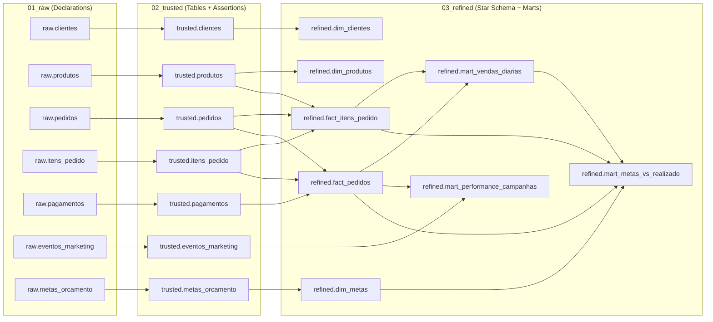

# Orquestração no BigQuery com Dataform — Veloja E-Commerce

Esta pasta contém a implementação do pipeline da **Arquitetura Medalhão (RAW $\rightarrow$ Trusted $\rightarrow$ Refined + Data Quality)** estruturada para execução automatizada no **Google Cloud Dataform**.

---

## 1. Relação com a pasta `sql/` (Mesma Regra de Negócio + Anotações de DAG)

O código SQL de transformação contido aqui é **exatamente o mesmo código que está na pasta [`../sql/`](../sql/)**. Nenhuma regra de limpeza, cálculo financeiro, deduplicação ou semáforo de metas muda.

A única diferença é que os arquivos `.sql` foram convertidos para a extensão **`.sqlx`** do Dataform Core, adicionando duas anotações principais que permitem ao BigQuery montar e executar a **DAG (árvore de dependências)** automaticamente:

1. **Bloco `config { ... }` no topo de cada arquivo:**
   * Substitui o `CREATE OR REPLACE TABLE ... AS` manual.
   * Define o tipo do recurso (`declaration`, `table` ou `assertion`), o dataset de destino (`trusted` ou `refined`), a descrição da tabela e os **testes de qualidade embutidos (`assertions`)**.
2. **Função `${ref("dataset", "tabela")}` no `FROM` e nos `JOINs`:**
   * Substitui o caminho fixo `` `veloja-ecommerce-medalhao.trusted.pedidos` `` por `${ref("trusted", "pedidos")}`.
   * É essa anotação `${ref(...)}` que informa ao Dataform **quem depende de quem**, permitindo que ele desenhe o grafo de linhagem (DAG) e execute as tabelas na ordem correta sem intervenção manual.

---

## 2. Comparativo Prático: `sql/` vs. `dataform/`

### Como está na pasta `sql/` (execução via script/CLI):

```sql
CREATE OR REPLACE TABLE `veloja-ecommerce-medalhao.refined.dim_produtos` AS
SELECT
  TO_HEX(MD5(product_id)) AS product_sk,
  product_id,
  sku,
  nome_produto,
  categoria,
  subcategoria,
  marca,
  preco_tabela,
  custo_unitario,
  (preco_tabela - custo_unitario) AS margem_unitaria,
  ativo,
  CURRENT_TIMESTAMP() AS data_processamento
FROM `veloja-ecommerce-medalhao.trusted.produtos`;
```

### Como fica na pasta `dataform/` (`dim_produtos.sqlx`):

```sql
config {
  type: "table",
  schema: "refined",
  name: "dim_produtos",
  description: "Dimensão de produtos com chave substituta (SK), catálogo, categorização e cálculo de margem unitária",
  tags: ["refined", "dimensao"],
  assertions: {
    uniqueKey: ["product_sk"],
    nonNull: ["product_sk", "product_id", "sku", "preco_tabela", "custo_unitario", "margem_unitaria"]
  }
}

SELECT
  TO_HEX(MD5(product_id)) AS product_sk,
  product_id,
  sku,
  nome_produto,
  categoria,
  subcategoria,
  marca,
  preco_tabela,
  custo_unitario,
  (preco_tabela - custo_unitario) AS margem_unitaria,
  ativo,
  CURRENT_TIMESTAMP() AS data_processamento
FROM ${ref("trusted", "produtos")}
```

---

## 3. Como o Dataform Funciona e Monta a DAG

Quando o Dataform compila esta pasta, ele lê todos os `${ref(...)}` e constrói o seguinte fluxo de execução (DAG):



1. **Execução em Paralelo:** Todas as 7 tabelas da camada `trusted` rodam simultaneamente porque só dependem das tabelas externas `raw`.
2. **Trava de Qualidade (`Assertions`):** Ao terminar cada tabela, o Dataform roda automaticamente as validações de chave única (`uniqueKey`), não-nulos (`nonNull`) e regras matemáticas (`rowConditions`).
3. **Ordem Garantida:** As tabelas Fato só iniciam após as tabelas Trusted terminarem; os Data Marts (`mart_vendas_diarias`, `mart_performance_campanhas` e `mart_metas_vs_realizado`) só iniciam após as Fatos e Dimensões concluírem; e por fim rodam os 4 testes cruzados da pasta `04_assertions/`.

---

## 4. Estrutura de Arquivos desta Pasta

```text
dataform/
├── workflow_settings.yaml                                  # Projeto, região (southamerica-east1) e política de agendamento
├── README.md                                               # Documentação do funcionamento do Dataform e da DAG
└── definitions/
    ├── 01_raw/                                             # 7 declarações das External Tables da camada RAW
    │   ├── raw_clientes.sqlx
    │   ├── raw_produtos.sqlx
    │   ├── raw_pedidos.sqlx
    │   ├── raw_itens_pedido.sqlx
    │   ├── raw_pagamentos.sqlx
    │   ├── raw_eventos_marketing.sqlx
    │   └── raw_metas_orcamento.sqlx
    │
    ├── 02_trusted/                                         # 7 tabelas da camada Trusted (limpeza, tipagem e dedup)
    │   ├── trusted_clientes.sqlx
    │   ├── trusted_produtos.sqlx
    │   ├── trusted_pedidos.sqlx
    │   ├── trusted_itens_pedido.sqlx
    │   ├── trusted_pagamentos.sqlx
    │   ├── trusted_eventos_marketing.sqlx
    │   └── trusted_metas_orcamento.sqlx
    │
    ├── 03_refined/                                         # 8 tabelas da camada Refined (Dimensões, Fatos e Marts)
    │   ├── dim_clientes.sqlx
    │   ├── dim_produtos.sqlx
    │   ├── dim_metas.sqlx
    │   ├── fact_itens_pedido.sqlx
    │   ├── fact_pedidos.sqlx
    │   ├── mart_vendas_diarias.sqlx
    │   ├── mart_performance_campanhas.sqlx
    │   └── mart_metas_vs_realizado.sqlx
    │
    └── 04_assertions/                                      # 4 testes de reconciliação contábil e integridade referencial
        ├── assert_reconciliacao_fato_vs_mart.sqlx
        ├── assert_reconciliacao_meta_diaria_vs_mensal.sqlx
        ├── assert_orfaos_pedidos_sem_cliente.sqlx
        └── assert_orfaos_itens_sem_produto.sqlx
```

---

## 5. Política de Agendamento em Produção

O pipeline é configurado no *Workflow Configuration* do Dataform no GCP para rodar dentro da janela comercial:

* **Expressão Cron:** `0 6-20 * * *` (a cada 1 hora cheia, das **06:00 às 20:00**).
* **Fuso Horário:** `America/Sao_Paulo`.
* **Pausa Noturna:** Das 21:00 às 05:00 não há disparos desnecessários, otimizando o consumo de processamento do BigQuery.
